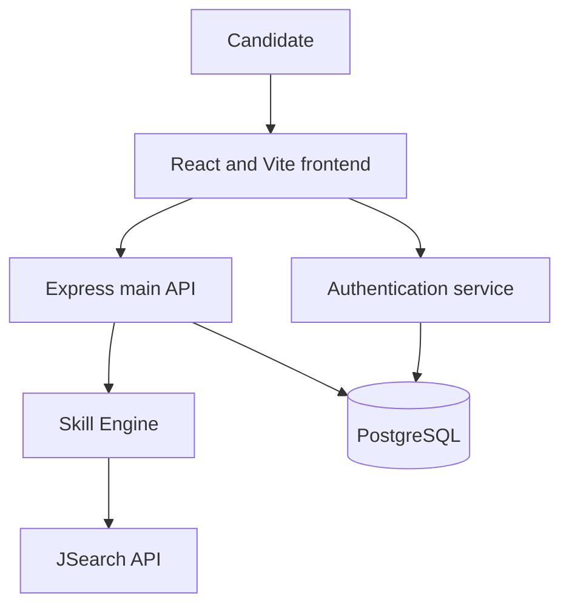

# DevPath — Project Description for AI Planning

## 1. Purpose of this document

This document describes DevPath so that a developer or AI assistant can create an implementation plan. It consolidates the supplied **DevPath Authentication System Report**, **DevPath Component Map**, and the project context provided by the owner.

**Project status:** DevPath is in the planning stage. No implementation has been confirmed. Although the report uses words such as “implemented,” “enforces,” and “maintained,” treat those statements as proposed architecture and requirements until a real repository and working system are verified. The report mentions a repository tag named `e3-microservice`; its existence has not been verified.

**Evidence labels:**
- **Stated:** Explicitly described in the report or project context.
- **Proposed:** A practical recommendation added to help planning; it is not an established project decision.
- **Open:** Needs a decision or further investigation.

The authentication report focuses on authentication; the component map adds the main screens, user stories, stack, and matching behavior. Both describe a planned system. Areas that are not defined are marked accordingly rather than presented as completed features.

## 2. Project overview

**Name:** DevPath — From Student to Job-Ready Developer.

**Purpose:** A web platform that helps software students and junior developers compare their current skills with the skills requested in job vacancies. The intended outcome is to make skill gaps visible and help users understand what they may need to learn to pursue a role.

**Primary audience:** Software development students, recent graduates, and junior developers.

**Core concept:** A user creates an account, provides profile and skill information, explores relevant vacancies, and receives an analysis comparing their skills with job requirements. A personalized learning path is part of the proposed scope; its content and generation method remain to be defined.

**Planned components:**
1. A React + Vite frontend.
2. An Express main backend API.
3. A custom authentication service using JWTs and HTTP-only cookies.
4. A skill-matching microservice, also called the Skill Engine.
5. A PostgreSQL database.
6. The external JSearch job search API.
7. Figma for interface design, and Git + GitHub for version control and collaboration.

The report identifies these components but does not fully specify deployment topology, service ownership of data, or communication between every pair of services.

## 3. Goals and scope

### 3.1 Product goals

- Allow a candidate to create and access an account.
- Collect and maintain the information needed for a professional profile.
- Give users a way to describe their software skills.
- Retrieve relevant job vacancy information from JSearch.
- Compare candidate skills with job requirements.
- Present matching skills, skill gaps, and a compatibility percentage.
- Provide a personalized learning path informed by vacancies, skills, and projects.
- Protect accounts and personal information.

### 3.2 Initial user information

The project context identifies the following personal information as intended to be stored:

| Information | Purpose or use | Status and clarification |
| --- | --- | --- |
| Name | Identify the user and display a profile. | Stated. Exact fields are open. |
| Email | Account identity and communication. | Stated. Verification and normalization rules are open. |
| Password | Authenticate the user. | Stated. Store only a secure password hash, never the plaintext password. |
| Location | Provide geographic context for the profile or job search. | Stated. Required precision and exact use are open. |
| CV / résumé | Provide professional background. | Stated. File format, storage, parsing, and visibility are open. |
| Skills | Compare a candidate against vacancies. | Stated by the platform purpose and skills API. Input method and model are open. |

Do not assume the CV is automatically parsed, shared with employers, or used to train AI: these behaviors have not been specified.

### 3.3 Boundaries and open scope

Employer accounts, direct applications, messaging, paid subscriptions, course providers, social login, notifications, and the use of AI to generate a learning plan are **not confirmed**. A personalized learning path itself is stated in the component map. An implementation plan may propose them as future options, but should not treat them as current requirements.


## 3.4 User stories, design, and screens from the component map

- **Recent graduate in Chihuahua:** Wants to paste a junior job description and compare it with their skills to understand which technologies to learn.
- **Junior developer:** Wants a learning path based on relevant vacancies and current projects to build practical evidence and close skill gaps.

The component map proposes an accessible, minimal interface with a **soft pink** palette, designed in Figma. It identifies three main screens:

1. **My Profile:** User profile, skills, and project portfolio. Exact fields, editing workflow, and privacy settings are open.
2. **Job Analysis:** Paste a vacancy description or use relevant job data, initiate analysis, and view matched skills, missing skills, and a compatibility percentage. The percentage formula and explanation are open.
3. **My Learning Path:** Present a personalized path informed by skills, relevant vacancies, and current projects. The structure, method of generation, progress tracking, and use of AI remain open.

Use progressive disclosure to avoid overwhelming users with technical metrics. Show a skeleton, spinner, or clear progress message during longer analysis. Node.js + Express is the stated backend stack, and Git + GitHub with feature branches, pull requests, code reviews, a README, and deployment setup are part of the proposed development workflow.

## 4. Main actors

| Actor | Relationship to DevPath |
| --- | --- |
| Candidate | Creates an account, manages personal information and skills, and uses job matching. |
| Frontend | Presents the interface and communicates with backend services. |
| Authentication service | Manages credential verification and the token lifecycle. |
| Main backend API | Handles application requests and coordinates domain operations. |
| Skill Engine | Analyzes job requirements against candidate skills. |
| PostgreSQL | Persists the application data that the system is designed to store. |
| JSearch API | Provides external job vacancy data, subject to its service terms and availability. |
| Project team | Defines requirements, implements, deploys, operates, and secures the system. |

The token example includes a `candidate` role. Other roles, permissions, and administrative features have not been defined.

## 5. Expected user journeys

The following journeys describe intended behavior and planning assumptions, not verified functionality.

### 5.1 Registration and profile

1. The user opens DevPath and chooses to register.
2. The interface collects the agreed registration data. Name, email, password, location, and CV are within the intended data scope; whether all are required at registration is open.
3. The backend validates the submitted information and handles duplicate accounts.
4. The password is hashed before storage.
5. The account and permitted profile data are stored.
6. The user can access the application after the chosen account activation process.

**Open:** Email verification, password policy, recovery, required fields, minimum age, user-facing privacy notice, and consent approach.

### 5.2 Login and authentication

1. The candidate submits credentials over HTTPS.
2. The authentication service locates the account and verifies the password against its stored hash.
3. If valid, the service issues a short-lived access token and a refresh token.
4. The frontend keeps the access token in memory; the refresh token is placed in a secure HTTP-only cookie.
5. The user can access authorized functionality. Invalid credentials should produce a safe, generic error.

### 5.3 Skills and job analysis

1. The user enters or updates their skills using a flow to be designed.
2. DevPath obtains vacancy information from JSearch or accepts vacancy text, depending on the selected flow.
3. The main backend sends the required analysis input to the Skill Engine.
4. The engine compares the candidate's skills with vacancy requirements.
5. The frontend presents the output, such as matched skills and gaps, in a clear format.

**Open:** Whether users choose a vacancy, enter free text, or use both; the detailed extraction and normalization method; how the compatibility percentage is calculated; and whether a language model is involved. No specific AI model is established in the source.

### 5.4 Learning path

1. The platform uses the candidate's skills, relevant vacancy requirements, and current projects to inform a personalized path.
2. The My Learning Path screen presents the resulting activities or goals.
3. The component map mentions progress data, but the exact tracking behavior is open.

The map does not define how recommendations are generated, whether an AI model is used, or which learning resources are included.

### 5.5 Logout

1. The user requests logout.
2. The service invalidates the relevant refresh session and clears the refresh cookie.
3. The frontend clears its in-memory access token and returns to the appropriate public view.
4. A previously issued access token can remain valid until expiry unless an additional revocation mechanism is introduced. The report's “immediate” logout therefore applies reliably to refresh capability and client state, not necessarily to all already-issued access tokens.

## 6. Architecture and responsibilities



This diagram is a planning-level interpretation of the report. Exact network boundaries, database ownership, deployment units, and any direct frontend-to-engine connection require confirmation.

### 6.1 Frontend: React + Vite

**Stated:** A React + Vite web client communicates with the authentication service and main API. The access token is intended to remain in memory.

**Expected responsibilities:**
- Render registration, login, profile, skills, search, and analysis interfaces as scope is confirmed.
- Validate input for usability while relying on server-side validation for security.
- Send access tokens with protected requests.
- Handle expired sessions, authorization errors, loading, and service outages.
- Request token refresh using the appropriate cookie settings.
- Display only information the user is authorized to access.

**Open:** UI framework, routing, state management, accessibility targets, supported languages and browsers, and deployment platform.

### 6.2 Main backend: Express API

**Stated:** An Express backend provides application endpoints, including the documented skills route, and calls the Skill Engine.

**Expected responsibilities:**
- Validate and authorize incoming requests.
- Manage user-related application data and skills within agreed boundaries.
- Call the Skill Engine using a secured service-to-service contract.
- Translate errors into safe, consistent responses.
- Coordinate persistence and external integrations as assigned in the final design.

**Open:** Language (JavaScript or TypeScript), API gateway, exact endpoint list, validation library, and service ownership.

### 6.3 Authentication service

**Stated:** A custom service manages credentials and issues access and refresh tokens. The report compares this approach with managed providers such as Auth0 and Firebase, noting greater control but greater security and operational responsibility.

**Expected responsibilities:**
- Manage registration and credential verification.
- Hash and verify passwords securely.
- Sign and issue access tokens and manage refresh sessions.
- Rotate refresh tokens and revoke them on logout.
- Apply rate limits and authentication logging.
- Protect signing keys and other secrets.

**Open:** Whether the auth service is a separately deployed microservice for the first version, which JWT algorithm and key-distribution strategy to use, and the refresh-token persistence model.

### 6.4 Skill Engine

**Stated:** A custom matching service accepts vacancy text and returns matching JSON. The report also shows it calling JSearch.

**Expected responsibilities:**
- Receive validated analysis inputs and a trusted user context.
- Obtain or process job vacancy data as directed by the main backend.
- Compare vacancy requirements against the relevant candidate skills.
- Return structured results that the frontend can explain.
- Handle provider errors and, if implemented, use a clearly labeled vacancy cache.

**Stated by the component map:** The engine extracts technologies such as React, Git, and Docker from job text, compares them with registered skills, and returns matches, gaps, and a compatibility percentage. It is intended to run as an independent REST service that can scale separately.

**Open:** Runtime and programming language, deterministic matching versus AI-assisted extraction, the scoring formula, required input schema, output schema, and whether the engine accesses the database or receives skills in the request.

**Trust boundary:** The report mentions an `X-User-Id` header. The engine must not trust this header from an arbitrary public client. Authenticate service-to-service requests, derive identity from a verified token or trusted backend, and enforce resource ownership. The report also says protected engine endpoints verify bearer tokens locally; decide whether the engine validates the user's token, receives authenticated internal requests, or uses both with explicit responsibilities.

### 6.5 PostgreSQL

**Stated:** PostgreSQL is the planned database. The report refers to credentials, profiles, user skills, saved paths, and audit information, but does not define a schema. The component map also mentions project portfolios, job information, and progress. The detailed schemas and how learning paths and progress are persisted remain open.

**Planning considerations:** data ownership per service, schema migrations, constraints, backups and restoration, indexing, access control, retention, and encryption. Database storage for CV files versus separate object storage is open.

### 6.6 JSearch API

**Stated:** JSearch is the external job vacancy provider, accessed using RapidAPI credentials. The report illustrates a request resembling `GET /search?query=Junior`.

**Expected responsibilities:**
- Search for vacancy data using agreed filters.
- Normalize provider results into DevPath's own data model.
- Respect provider quotas and applicable terms.
- Handle rate limits, malformed results, timeouts, and outages.
- Keep API credentials on the server.

Actual endpoints, required parameters, usage limits, current pricing, permissions, attribution, and caching rules must be verified against current provider documentation before implementation.

## 7. Authentication and authorization specification

### 7.1 Token lifecycle

| Item | Report's proposed policy | Planning note |
| --- | --- | --- |
| Access token | JWT, valid for 15 minutes. | Keep in frontend memory and send as a bearer token. |
| Refresh token | Valid for 7 days. | Store in an HTTP-only secure cookie and rotate on each refresh. |
| Refresh rotation | Single use. | Atomically invalidate the previous token and issue a new one; define reuse detection and concurrent request behavior. |
| Logout | Clear cookie and revoke refresh token. | Existing access tokens may remain usable until they expire. |

**Example claims from the report:**

```json
{
  "sub": "user_id_uuid",
  "identity": "user_account",
  "role": "candidate",
  "iss": "devpath_auth_service",
  "exp": 1761847066
}
```

The values are illustrative; the expiration is not a reusable future timestamp. The final contract must specify the exact identity value, issuer, audience, signing algorithm, validation rules, and which claims are necessary. Avoid personal or sensitive information in JWT claims.

### 7.2 Protected requests

1. The frontend attaches `Authorization: Bearer <access_token>`.
2. The receiving service validates the token's signature, allowed algorithm, expiration, issuer, audience, and relevant claims according to the final design.
3. The service checks the user's permission and ownership of the requested resource.
4. Invalid or expired credentials produce a `401` response; valid credentials without the required permission produce `403` where appropriate.

Stateless token verification does not mean the entire application is stateless: profile reads, refresh-token rotation, and revocation may still require persistent state.

### 7.3 Cookies and browser security

- Set the refresh cookie to `HttpOnly` and `Secure` in HTTPS deployments.
- Choose `SameSite`, cookie path, domain, lifetime, and cross-origin behavior based on the actual deployment topology.
- Provide CSRF protection for cookie-authenticated state-changing endpoints; `SameSite` and strict origin validation can be part of a defense, but the exact design must be decided.
- Restrict CORS to approved origins and configure credentials intentionally.
- Do not store refresh tokens in browser local storage. An in-memory access token reduces persistence but does not eliminate XSS risk.

### 7.4 Passwords, keys, and sessions

The report calls for salted password hashing with a cost factor of 12 and a strong 256-bit signing secret. The hashing algorithm and JWT signing algorithm are not specified, so cost settings cannot be assumed to apply universally. Choose and document an appropriate password hashing algorithm and work factor; use securely generated keys appropriate to the chosen JWT algorithm. If several services verify JWTs, decide how verification keys reach them and how keys rotate. If asymmetric signing is selected, only the authentication service should hold the private signing key.

Never commit credentials or secrets. Do not log passwords, tokens, CV contents, or unnecessary personal data.

## 8. Interfaces and API contracts

The report describes the following interactions. They are not confirmed to exist. Placeholder routes and bodies should not be treated as final implementation contracts.

| Source → target | Reported request | Reported response or failure |
| --- | --- | --- |
| Frontend → auth | `POST /api/v1/auth`; JSON credentials; `Content-Type: application/json`. | `200` token response; `401` authentication refused; `429` rate limited. |
| Frontend → main API | `GET /api/v1/skills`; bearer access token. | `200` user skills; `401` expired or invalid token; `403` forbidden. |
| Main API → Skill Engine | `POST /api/v1/analyze`; vacancy text in JSON and an `X-User-Id` header. | `200` matching JSON; `400` invalid input; `503` unavailable. |
| Skill Engine → JSearch | `GET /search?query=Junior`; RapidAPI key and host headers. | `200` vacancy data; `429` rate limit; provider outage or error. |

The auth route above is a high-level example from the report, not a complete authentication API. Registration, login, refresh, and logout routes, payloads, status codes, and error formats remain to be designed. The token response must be consistent with the chosen cookie design; the refresh token should not also be exposed in a readable JSON response if it is intended to be HTTP-only.

**Proposed common error shape:**

```json
{
  "error": {
    "code": "INVALID_INPUT",
    "message": "Please review the submitted information.",
    "requestId": "example-request-id"
  }
}
```

Use stable machine-readable codes and safe messages. Define field validation errors, pagination, timeouts, retry behavior, and API versioning before implementation.

## 9. Data model: planning starting point

The following is a conceptual model, not a finalized schema.

| Entity | Potential fields | Relationship / decisions |
| --- | --- | --- |
| User account | ID, email, password hash, role, created and updated timestamps. | Unique normalized email policy and account states need decisions. |
| Candidate profile | User ID, name, location, timestamps. | Decide location precision and mandatory fields. |
| CV record | Owner ID, storage reference, file metadata, timestamps. | Decide allowed file types, size, storage, scanning, deletion, and access. |
| Skill | ID, normalized name, optional category. | Decide whether skills use a controlled catalog, free text, or both. |
| Candidate skill | User ID, skill ID, optional level and evidence. | Define the meaning and validation of proficiency. |
| Vacancy | Provider, provider ID, title, description, location, source URL, retrieved time. | Cache only if permitted by provider terms; define freshness and deletion. |
| Analysis | User ID, vacancy reference or text, result, creation time. | Decide whether analysis is persisted and how it is explained. |
| Refresh session | User ID, token identifier or hash, expiry, revocation state, rotation metadata. | Do not store raw refresh tokens if a secure hash or equivalent is used. |
| Security event | Event type, relevant user/session ID, time, limited metadata. | Define retention, access, and redaction. |

**Relationships:** A candidate owns a profile and may have multiple skills, CV records, analyses, and refresh sessions, depending on final product rules. A vacancy may be associated with multiple analyses. Define deletion and cascading behavior explicitly.

### Additional conceptual entities from the component map

- **Portfolio project:** User-owned project information that may inform the learning path; fields and evidence requirements are open.
- **Learning path and progress:** User-specific learning goals and progress; generation rules, storage, and update behavior are open.
- **Technology catalog:** A standardized set of skill tags and aliases (for example, JS, Javascript, and JavaScript) to improve matching. Governance and normalization rules need design.

## 10. Privacy and data protection

The project intends to process personal information including names, email addresses, approximate or precise location, CVs, and authentication data. The privacy notice and consent approach have not yet been decided.

Planning must determine:
- What data is necessary for each feature and whether a field is required or optional.
- The notice presented to users, the purposes of processing, applicable legal basis, and when consent is required. Legal requirements should be reviewed for the jurisdiction and actual use.
- Whether CVs are visible only to their owners or shared with any third party.
- How users can access, correct, export, or delete their information, as applicable.
- Retention and deletion periods for accounts, CVs, logs, analysis results, and cached vacancies.
- Whether external AI or other providers receive profile or CV information, and under what safeguards.
- File upload security: type and size limits, safe storage, authorization, and malware scanning where appropriate.
- Access control, backup protection, and incident response responsibilities.

Do not include real personal data in test fixtures without authorization.

## 11. Security requirements

**Stated in the report:** TLS, environment-separated secrets, password hashing, parameterized PostgreSQL queries, restricted CORS, safe error responses, role and ownership checks, short access-token expiry, and refresh-token rotation.

**Additional planning controls:**
- Validate all inputs on the server and apply request-size limits.
- Protect registration, login, and refresh against abuse with appropriately configured rate limiting.
- Use parameterized queries or a correctly configured database library; avoid building SQL from untrusted input.
- Enforce authorization in the backend for every profile, CV, skill, and analysis operation.
- Prevent XSS through safe rendering, output handling, and a suitable content security policy.
- Authenticate internal service calls and limit network exposure.
- Set timeouts and sensible retry limits when calling external services.
- Use dependency scanning, secret scanning, updates, and a documented incident response process.
- Keep production errors free of stack traces and secrets while recording actionable, sanitized server logs.

The report labels several categories as OWASP 2025; verify the exact edition and category names if formal compliance or academic citation is required. A list of controls alone does not establish compliance.

## 12. Failure handling and resilience

| Failure | Expected impact | Planned behavior |
| --- | --- | --- |
| Authentication service unavailable | Login, registration, and refresh cannot complete. | Show an informative error. Existing access tokens may continue until expiry only if verification keys and dependent services remain available. |
| PostgreSQL unavailable | Stateful reads and writes fail. | Return a safe `503` when applicable and show an appropriate maintenance message. A `Retry-After` header can be used when a meaningful retry time is known. |
| JSearch unavailable or rate limited | Live job search and analyses requiring fresh vacancies may fail. | Show a clear message; optionally use permitted, nonexpired cached data with a visible timestamp. A cache is a proposed feature until implemented and provider terms are checked. |
| Skill Engine unavailable | Matching cannot complete. | Keep other available parts of the app usable and explain that analysis is temporarily unavailable. |
| Expired access token | Protected request fails. | Attempt a controlled refresh if a valid session exists; otherwise prompt for login. Avoid infinite refresh loops. |
| Refresh token revoked or reused | Session cannot be renewed. | Reject refresh, clear affected session where appropriate, and require login. |

## 13. Quality and acceptance criteria

These are proposed starting criteria to refine into testable project requirements.

### Functional

- A user can register and log in using the agreed required fields.
- Duplicate email registration is handled without exposing unnecessary account information.
- A candidate can create and update their own profile and skills.
- CV upload and access work according to the chosen file and privacy rules.
- A protected request is accepted for an authorized user and rejected when authentication or permission is missing.
- A user can paste a job description and request analysis; the precise workflow for browsing provider vacancies remains to be defined.
- Analysis identifies matched and missing technologies and returns a compatibility percentage, using a documented calculation.
- The learning path screen presents a personalized path based on the agreed inputs.
- Results clearly distinguish matched skills from gaps, if these outputs are selected in the design.
- Logging out prevents further refresh with the revoked session.

### Security

- Passwords are never stored in plaintext and are not returned by APIs.
- The API rejects expired, altered, or otherwise invalid JWTs.
- One user cannot access another user's protected resources by changing an identifier.
- Refresh cookies have the intended flags; CSRF defenses match the deployment topology.
- Refresh rotation rejects reuse according to the final session policy.
- Secrets and sensitive data are absent from repository history, logs, and client bundles.

### Reliability and usability

- The application handles invalid input and service failures with understandable messages.
- Job search or matching failures do not unnecessarily block unrelated features.
- The interface is usable with keyboard navigation and has accessible labels and adequate contrast; select a specific accessibility target.
- Backup restoration and dependency failure handling are tested before production.

## 14. Testing approach

- **Unit tests:** token and claim validation, password verification, input validation, skill matching and normalization, and mapping of job provider responses.
- **Integration tests:** authentication with a test database; registration and duplicate handling; refresh rotation and logout; ownership checks; API-to-engine communication; provider error handling with controlled test doubles.
- **End-to-end tests:** registration, login, profile and skills management, selected vacancy analysis workflow, session expiry, and logout.
- **Security tests:** tampered tokens, wrong issuer or audience, expired tokens, access to another user's data, rate limiting, CSRF defenses, and unsafe uploads.
- **Resilience tests:** database unavailable, provider timeout or `429`, Skill Engine unavailable, and auth service unavailable.
- **Privacy tests:** deletion behavior, authorization around CV access, and log redaction.

Use nonproduction credentials and representative fictional data. Define measurable performance targets after expected usage is known.

## 15. Deployment and operations

**Stated technology:** React + Vite, Express, a custom auth service and Skill Engine, PostgreSQL, and JSearch.

**Not yet chosen:** Hosting provider, deployment method, infrastructure, CI/CD tooling, domain names, environments, database provider, and observability stack.

**Proposed operational checklist:**
- Separate local, test, and production configuration.
- Maintain example environment variable names without real secrets.
- Apply database migrations through a repeatable process.
- Configure HTTPS, trusted origins, secrets, health checks, and least-privilege service credentials.
- Record structured logs, metrics, and alerts without sensitive data.
- Schedule backups and test restoration.
- Document setup, deployment, rollback, and incident response.
- Maintain API contracts and a repeatable test suite.

Potential configuration categories include database connection, auth signing and verification keys, token lifetimes, allowed frontend origins, cookie settings, service URLs, JSearch credentials, and storage settings. Exact names and defaults remain open.

## 16. Decisions an AI planning assistant must resolve

1. What is the minimum viable product and which features are required for the academic delivery?
2. Which data is collected at registration versus later in the profile?
3. How are CVs stored, protected, updated, deleted, and optionally processed?
4. Which privacy notice, consent and retention rules apply?
5. What skills model, proficiency scale, and input method should be used?
6. How will users select or submit job vacancies, and which JSearch parameters and terms apply?
7. How will matching work, how will a score be explained, and is any AI model actually needed?
8. Will analyses and job searches be saved? How are learning paths generated, displayed, and tracked?
9. Is the authentication service a separate deployment in the first release?
10. Which JWT algorithm, keys, claims, audiences, session persistence and revocation policies are selected?
11. How will the frontend, main API, and Skill Engine authenticate to one another?
12. What are the exact API routes, request and response schemas, and error conventions?
13. What deployment, accessibility, language, testing, and performance targets apply?
14. What existing repository or artifacts, if any, should be inspected before planning implementation?

## 17. Suggested prompt for the next AI

> Act as a senior software architect and project planner. Read this entire DevPath project description. The project is in the planning stage, so do not assume that any feature, service, repository, tag, or security control has already been implemented. Distinguish stated requirements from recommendations and unresolved questions. First identify critical missing decisions and dependencies. Then create an actionable MVP implementation plan with phases, deliverables, tasks, dependencies, acceptance criteria, tests, security and privacy work, and clear assumptions. Cover the frontend, backend, authentication, database, skill engine, JSearch integration, deployment, and documentation. Flag any proposed feature that expands scope. Ask targeted questions where a decision materially changes the plan, and provide reasonable alternatives without silently presenting them as established facts.

## 18. Source and limitations

- Sources: **DevPath Authentication System Report** and **DevPath Component Map**, supplied by the project owner. The former focuses on authentication and component interfaces; the latter describes the broader product, user stories, design, stack, and matching engine.
- Additional project context: DevPath serves software students and junior developers, is still being planned, and is intended to store name, email, password, location, and CV. The privacy notice and consent approach have not been decided.
- The source contains diagrams and brief contracts; the text available for this description does not establish all design details or verify a running implementation. Confirm against the actual repository and project owner before coding.
