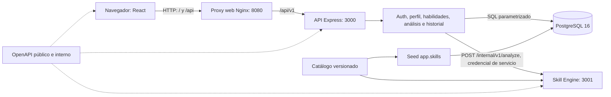
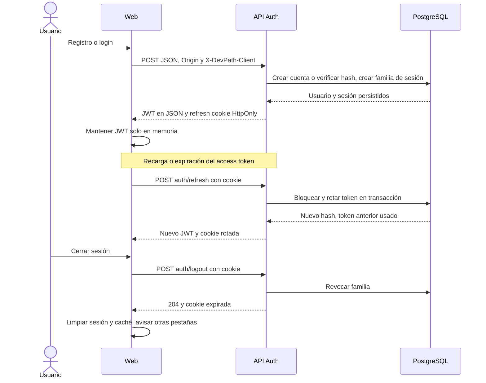
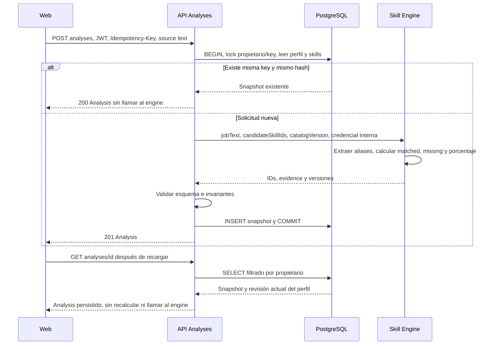

# Arquitectura implementada de DevPath M1

Actualización CTR-02: M1 se publicó como [v0.1.0](https://github.com/Om4r28xz/Dev_Path/releases/tag/v0.1.0) en `1f9e721a320270a415d0825e75a92f10f0d0b35d`, sincronizado a develop por PR #42 (`fc9f41b`). La descripción histórica siguiente corresponde al desarrollo de M1. Los [contratos posteriores](../packages/contracts/EXTENDED-CONTRACTS.md) definen proyectos/CV de M2 y propuestas jobs/rutas de M3/M4; no incorporan endpoints, pantallas ni migraciones a la aplicación publicada.

Referencia: `develop` **c564a57**, 2 de noviembre de 2026. Describe código integrado,
incluidos ANL-01/02/03/04 y el contrato público de evidence. La disponibilidad del código
no equivale a aceptación humana ni a publicación de `v0.1.0`.

## Alcance y componentes

M1 permite crear una cuenta, mantener una sesión, editar perfil/habilidades, pegar una
vacante, compararla con el catálogo, consultar resultados persistidos e historial y borrar
análisis propios. La extracción y el scoring son deterministas: no se usa IA generativa.



| Área            | Implementación y responsabilidad                                                                                                                                        |
| --------------- | ----------------------------------------------------------------------------------------------------------------------------------------------------------------------- |
| Web             | `apps/web`: React, Vite, React Router y TanStack Query. Solo llama rutas relativas `/api/v1`; no importa DB ni llama directamente al engine.                            |
| API pública     | `apps/api`: Express, Zod, `pg`; módulos auth, profile y analyses. Único propietario de las conexiones PostgreSQL y de la identidad del usuario.                         |
| Skill Engine    | `apps/skill-engine`: proceso Express separado, catálogo local, extracción y scoring. Recibe texto e IDs de skills; no recibe el JWT del usuario ni consulta PostgreSQL. |
| Persistencia    | `packages/db`: esquemas y migraciones Drizzle, pool/seed. Repositorios de API usan SQL parametrizado mediante `pg`; Drizzle no sustituye todos esos repositorios.       |
| Fronteras HTTP  | `packages/contracts`: OpenAPI, ejemplos, generación TypeScript y validación. Público 1.1.0; interno 1.0.0.                                                              |
| Catálogo        | `packages/catalog/technologies.json`: versión 1.0.0, diez tecnologías; IDs canónicos, alias y corpus sintético.                                                         |
| Ejecución local | `infra/compose.yaml`, Dockerfiles y `infra/proxy/default.conf`; scripts `setup-local.mjs` y `dev-local.mjs`.                                                            |

Auth es un módulo de la API, **no** un tercer servicio. La API y el engine sí son procesos
separados. ESLint restringe las importaciones de DB desde web y engine; las fronteras no
dependen únicamente de la organización de carpetas.

## Pantallas y endpoints disponibles

Las rutas indicadas son relativas al mismo origen web. Los endpoints protegidos requieren
`Authorization: Bearer <accessToken>`; el catálogo público no usa ese requisito.

| Pantalla/uso                       | Operación HTTP                                   | Resultado                                                             |
| ---------------------------------- | ------------------------------------------------ | --------------------------------------------------------------------- |
| `/register`                        | `POST /api/v1/auth/register`                     | 201: sesión, usuario y refresh cookie.                                |
| `/login`                           | `POST /api/v1/auth/login`                        | 200: sesión y refresh cookie.                                         |
| Bootstrap/401                      | `POST /api/v1/auth/refresh`                      | 200: nueva sesión y cookie rotada; 401 si inválida.                   |
| Cerrar sesión                      | `POST /api/v1/auth/logout`                       | 204: revoca familia y elimina cookie.                                 |
| `/profile`                         | `GET /api/v1/me`, `PATCH /api/v1/me`             | Perfil propio; edición de nombre, titular y ubicación.                |
| `/profile`                         | `GET /api/v1/skills?q=...&limit=...&cursor=...`  | Catálogo paginado con `catalogVersion`, `items`, `nextCursor`.        |
| `/profile`                         | `GET /api/v1/me/skills`, `PUT /api/v1/me/skills` | Lectura/reemplazo completo de skills canónicas propias.               |
| `/analysis/new`                    | `POST /api/v1/analyses`                          | 201 nuevo / 200 replay; exige `Idempotency-Key` UUID y fuente `text`. |
| `/analyses`                        | `GET /api/v1/analyses?limit=20&cursor=...`       | `items: AnalysisSummary[]` y `nextCursor`.                            |
| `/analyses/:id`                    | `GET /api/v1/analyses/:analysisId`               | Snapshot `Analysis` propio, evidence opcional.                        |
| Historial, diálogo de confirmación | `DELETE /api/v1/analyses/:analysisId`            | 204 propio; 404 ajeno/inexistente.                                    |
| Operación de servicios             | `GET /health/live`, `GET /health/ready`          | En API y engine, fuera del prefijo de negocio.                        |
| Solo API → engine                  | `POST /internal/v1/analyze`                      | Contrato interno; Bearer de servicio, distinto del JWT público.       |

El formulario de análisis admite título opcional de hasta 120 caracteres y texto de 1 a
20 000 unidades UTF-16. No acepta `candidateSkillIds` ni `userId` desde el navegador:
la API obtiene ambos del usuario autenticado y sus skills guardadas.

## Registro, acceso y sesión



- Registro crea `auth.users`, perfil y familia de sesión transaccionalmente. Las contraseñas
  usan Argon2id: memoria 19 456 KiB, dos iteraciones, paralelismo 1 y hash de 32 bytes.
  El login de cuenta inexistente también verifica un hash ficticio para reducir diferencias temporales.
- Access JWT RS256 firmado con clave RSA de al menos 2048 bits; duración 900 segundos,
  `iss=urn:devpath:auth`, `aud=devpath-api`, `sub=user.id`, `typ=at+jwt`, rol candidato y `jti`.
  La verificación deriva `response.locals.userId`; no se acepta identidad por cabecera arbitraria.
- Refresh opaco aleatorio de 32 bytes, siete días de vencimiento absoluto por familia.
  Solo se almacena SHA-256 del refresh, junto con uso/revocación. La rotación es atómica;
  reutilizar un token usado revoca su familia. Rotar no extiende el vencimiento absoluto.
- Cookie normal `__Secure-devpath_refresh`: `HttpOnly`, `Secure`, `SameSite=Lax`,
  `Path=/api/v1/auth`, sin dominio compartido. En HTTP loopback autorizado,
  `AUTH_LOCAL_HTTP=true` usa `devpath_refresh` sin `Secure`. Compose es una demostración
  HTTP local, no una configuración HTTPS de producción.
- Auth exige JSON, origen/referer permitido y `X-DevPath-Client: web`; aplica `no-store`
  y límite propio de 60 solicitudes/minuto por IP. No basta disponer de una cookie para
  enviar una petición de auth desde cualquier origen.
- `BrowserSession` mantiene el access token en memoria; no usa localStorage/sessionStorage
  para credenciales. Bootstrap usa refresh. Web Locks serializa rotaciones entre pestañas;
  BroadcastChannel comunica sesión/logout. Sin Web Locks no se garantiza exclusión entre pestañas.
- Al cambiar identidad se cancelan queries y se limpia TanStack Query antes de exponer la
  nueva sesión. Los accesos protegidos esperan bootstrap. Un refresh ambiguo deja sesión
  `unavailable` y permite recuperación explícita; no se repite ciegamente una cookie rotada.
- Logout revoca el refresh; el JWT ya emitido sigue siendo verificable hasta su expiración.
  No existe una lista de revocación inmediata de access tokens. La web lo elimina y comunica el logout.

Fuentes: `apps/api/src/modules/auth/{http,services,repositories}` y
`apps/web/src/lib/session/session.ts`.

## Análisis manual y fórmula



1. La UI conserva un intento con UUID estable ante errores ambiguos. Editar la solicitud
   cambia el intento; reintentar la misma conserva la key. El borrador no es un almacenamiento
   persistente de vacantes: la recuperación después de recargar corresponde al análisis ya guardado.
2. La API valida `source`, toma skills de PostgreSQL y limita a 100 IDs. Calcula SHA-256
   del comando normalizado `{source:{type,title,text}}`, adquiere un lock transaccional
   por propietario/key y consulta si existe una respuesta. Misma key y contenido diferente
   responde 409 `IDEMPOTENCY_KEY_REUSED`; misma key/contenido devuelve 200 del snapshot.
3. Un lock compartido del perfil protege la revisión de skills durante el cálculo. La
   sustitución de skills es transaccional; cambia la revisión cuando cambia el conjunto.
4. Engine recibe `jobText`, `candidateSkillIds` y `catalogVersion`. Usa NFKC con mapa de
   offsets al original, alias literales escapados, límites Unicode y prioridad del alias
   más específico en solapamientos. Deduplica IDs y limita menciones a 20 por skill.
   Reconoce patrones acotados de negación ES/EN; no entiende toda negación del lenguaje natural.
5. Para tecnologías detectadas `R` y skills del candidato `C`:
   `matched=R∩C`, `missing=R−C`, `matchPercentage=round(100×|matched|/|R|)`.
   `R` vacío produce **null**, no cero. JS+React frente a JS+React+Git: `round(200/3)=67`.
   El DTO público llama al campo `compatibilityPercentage`; no es probabilidad de contratación.
6. La API comprueba IDs canónicos, particiones, porcentaje y evidence antes de persistir;
   cualquier fallo interno provoca rollback. No se transforma una respuesta inválida en éxito.

Snapshot en `app.analyses`: propietario, key/hash, título/texto, skills del candidato,
required/matched/missing, porcentaje, revisión de skills, versiones, warnings, evidence y fecha.
Catálogo 1.0.0, extractor 1.1.0 y scorer 1.1.0 se conservan por análisis; no se actualiza
la historia al editar skills. `skillsOutdated` compara revisiones al leer, no cambia el scoring.
No se envía el texto completo almacenado al DTO público.

## Evidence y visualización segura

`Analysis` contiene `id`, `source:{type:'text',title}`, `candidateSkillsRevision`,
`requiredSkillIds`, `matchedSkillIds`, `missingSkillIds`, `compatibilityPercentage`,
`versions:{catalog,extractor,scoring}`, `warnings`, `skillsOutdated`, `createdAt` y
el opcional `evidence:[{skillId,matches:[{text,start,end}]}]`.

Evidence son **menciones literales de alias**, no párrafos ni HTML interpretado. `start`
es inclusivo y `end` exclusivo en unidades UTF-16 del texto original. La proyección de API
trata JSONB histórico como desconocido y valida catálogo disponible, cobertura completa de
required, offsets/slice, alias, duplicados y límites (100 grupos, 1–20 matches por grupo,
textos de 1–100 unidades). Si no puede validarlo, omite el opcional completo. También lo
omite si el DTO con evidence supera 128 KiB UTF-8. No altera la fila ni agrega warnings nuevos.

- `evidence` ausente: no disponible/validada, incluidos registros antiguos o catálogo histórico no disponible.
- `evidence: []`: no hay tecnologías detectadas; no se confunde con ausencia.
- React renderiza `{match.text}` en `<q>` y títulos como texto; no usa `dangerouslySetInnerHTML`.
  Required/matched/missing siguen visibles aunque evidence falte. Se muestran nombres del
  catálogo con fallback al ID si el cliente no conoce un nombre histórico.

`POST` nuevo, replay y detalle comparten la proyección. El listado conserva
`AnalysisSummary` sin evidence, skills ni texto completo; el enlace al detalle permite ver
tecnologías sin ampliar el contrato del resumen. Véase [ADR 0004](adr/0004-analysis-evidence.md).

## Historial y eliminación

`GET /analyses` usa orden descendente `(created_at,id)` y paginación keyset, por defecto
20 filas y máximo 50. El cursor base64url canónico contiene versión, propietario,
timestamp con microsegundos e ID; no es un token de autorización ni está cifrado.
La API valida formato y propietario y mantiene siempre el filtro `user_id` en SQL.
La migración 0003 añade el índice `(user_id,created_at DESC,id DESC)`.

La UI separa vacío, carga, error inicial y fallo al cargar otra página. Permite reintentos
y avisa si cambiaron skills. Cache de historial/detalle incorpora la identidad; se cancela
al cambiar cuenta. DELETE usa una sola sentencia filtrada por propietario. La confirmación
modal mantiene foco, Escape cancela y la UI invalida el historial después del 204.
Eliminar no modifica las habilidades ni su revisión. Detalle ajeno e inexistente responden
404; un UUID mal formado responde 400 en API y la pantalla lo presenta como no encontrado.

## Seguridad y fallos de dependencias

| Control/fallo                        | Comportamiento implementado                                                                                                                                            |
| ------------------------------------ | ---------------------------------------------------------------------------------------------------------------------------------------------------------------------- |
| Autorización                         | Identidad exclusivamente desde JWT verificado; SELECT/DELETE filtrados por propietario. No confiar en la opacidad del UUID o cursor.                                   |
| SQL y entrada                        | Queries parametrizadas, esquemas Zod estrictos y límites por operación. API JSON máximo 128 KiB; engine 64 KiB.                                                        |
| Engine                               | Credencial Bearer interna separada; no expuesto por proxy ni por puertos host de Compose. Red interna; no TLS interno ni mTLS configurados.                            |
| Dependencia caída/respuesta inválida | 503 `DEPENDENCY_UNAVAILABLE`; UI mantiene borrador y permite retry. API no registra un análisis fallido.                                                               |
| Plazo agotado                        | Engine client 3 s; presupuesto total de creación 5 s con cancelación y timeouts SQL; 504 `DEPENDENCY_TIMEOUT`.                                                         |
| Auth/DB no disponibles               | 503 genérico, sin SQL ni parámetros. Perfil puede seguir funcionando si solo falla engine.                                                                             |
| Conflicto de key                     | 409; requiere revisar solicitud, no modificar resultados esperados para hacer pasar pruebas.                                                                           |
| Entrada inválida / sin token         | 400 / 401 según contrato; auth también 403 para origen/cliente y 415 para media type.                                                                                  |
| Rate limit                           | API y engine: 120 peticiones por minuto por IP por defecto, configurable; auth añade 60/minuto. 429 al superar. Es memoria de cada proceso, no un límite distribuido.  |
| Privacidad                           | Auth/análisis usan `no-store`; logging estructurado evita credenciales/contenido sensible. No registrar vacantes, passwords, tokens o respuestas de auth en evidencia. |
| HTTP                                 | CORS con orígenes explícitos, cabeceras de seguridad y correlación por `X-Request-Id`; límites de body y apagado ordenado.                                             |

Los errores HTTP usan la envoltura del contrato con `error.code`, `message` y `requestId`.
La API no devuelve errores crudos del driver. Readiness de API consulta PostgreSQL;
**no comprueba engine**. Readiness/live y sus healthchecks no sustituyen un smoke de análisis.
Shutdown deja terminar solicitudes y cierra el pool; timeout por defecto 10 s.

No se garantiza ausencia de PII en una vacante pegada: la UI debe usarse con datos
autorizados y las pruebas con datos sintéticos. Evidence reduce exposición a alias,
pero no implementa un clasificador de datos personales ni una política de retención automática.

## Datos y contratos

- `auth.users`, `auth.session_families`, `auth.refresh_tokens`: identidad, familias y hashes de refresh.
- `app.profiles`, `app.skills`, `app.user_skills`: perfil, catálogo persistido y relación de skills/revisión.
- `app.analyses`: snapshots e idempotencia únicos por usuario/key; JSONB evidence y texto original.
- Migraciones 0000–0003 están en `packages/db/migrations`, con metadatos Drizzle.
  El seed hace upsert del catálogo; no crea cuentas de demostración.

Fuentes canónicas: [público](../packages/contracts/openapi/public.yaml) e
[interno](../packages/contracts/openapi/engine.yaml). Los tipos generados no ejecutan
validación por sí solos: API/engine usan esquemas e invariantes y la web valida respuestas.
Los ejemplos están en `packages/contracts/examples`; `pnpm --filter @devpath/contracts test`
valida documentos y ejemplos; `build` regenera y comprueba tipos. Los cambios de contrato
requieren coordinación P4+P1/P2; DOC-02 no cambia DTOs ni OpenAPI.

## Configuración y ejecución

| Variable                                            | Uso y valor por defecto/condición                                                                                                                                                 |
| --------------------------------------------------- | --------------------------------------------------------------------------------------------------------------------------------------------------------------------------------- |
| `NODE_ENV`                                          | `development`, `test` o `production`; default development.                                                                                                                        |
| `HOST`, `PORT`                                      | API 127.0.0.1:3000; engine 127.0.0.1:3001. Compose usa 0.0.0.0 dentro del contenedor, sin publicar esos puertos al host.                                                          |
| `DATABASE_URL`                                      | Obligatoria para API/migraciones/seed; exclusiva del backend.                                                                                                                     |
| `AUTH_PRIVATE_KEY_FILE`                             | PEM PKCS#8 RSA ≥2048 bits, obligatoria en API; local `.local-data/keys/access-private.pem`.                                                                                       |
| `AUTH_LOCAL_HTTP`                                   | Solo literal `true` habilita cookie local sin Secure; exige orígenes HTTP loopback explícitos.                                                                                    |
| `CORS_ALLOWED_ORIGINS`                              | CSV de orígenes explícitos; default desarrollo http://localhost:5173 (127.0.0.1 requiere configuración explícita); producción exige configuración. Compose http://localhost:8080. |
| `ENGINE_URL`                                        | API→engine; default http://127.0.0.1:3001; Compose http://engine:3001. Sin credenciales/query/hash/ruta arbitraria en URL.                                                        |
| `ENGINE_SERVICE_SECRET`                             | Misma credencial interna en API/engine; obligatoria no vacía en producción. Desarrollo tiene fallback `dev-secret`; setup genera secreto aleatorio.                               |
| `RATE_LIMIT_MAX_REQUESTS`, `RATE_LIMIT_WINDOW_MS`   | Límites globales por proceso; default 120 / 60000 ms; no cambian el límite propio de auth.                                                                                        |
| `SHUTDOWN_TIMEOUT_MS`                               | Default 10000; permitido 1000–60000 ms.                                                                                                                                           |
| `POSTGRES_USER`, `POSTGRES_PASSWORD`, `POSTGRES_DB` | Solo configuración Compose generada localmente en `infra/.env`; no confundir con configuración pública web.                                                                       |

Node >=22.16 <23 y pnpm 11.22.0 según manifiesto/lockfile. Procedimiento completo y
advertencias de conservación de datos: [SETUP_LOCAL.md](SETUP_LOCAL.md).

```sh
pnpm install --frozen-lockfile
node scripts/setup-local.mjs
pnpm build
# Con Docker disponible, desde la raíz:
docker compose --env-file infra/.env -f infra/compose.yaml up -d db
docker compose --env-file infra/.env -f infra/compose.yaml run --rm migrate
docker compose --env-file infra/.env -f infra/compose.yaml run --rm seed
docker compose --env-file infra/.env -f infra/compose.yaml up -d
```

La web se abre en http://localhost:8080. Nginx sirve SPA y envía `/api` a API; no publica
`/internal`. DB no publica 5432 al host y persiste en el volumen nombrado `database`.
No usar `down -v` para reiniciar una instalación con datos. En modo desarrollo, el proxy
Vite usa 127.0.0.1:5173 y API 3000; [setup](SETUP_LOCAL.md) describe variables y runner local.
`setup-local` crea configuración/clave, no migra por sí solo PostgreSQL ni instala Docker.

Validaciones de la base: `pnpm lint`, `pnpm format:check`, `pnpm typecheck`, `pnpm build`,
`pnpm test` (integraciones DB requieren `TEST_DATABASE_URL` aislada, migrada y sembrada).
El script de navegador existente en `apps/web/tests/integration` es un insumo de ANL-04.
La suite QAA-01 y su job Playwright se entregan en otro PR: no son código integrado de
esta base ni sustituyen aceptación P5. Los resultados concretos se registran en el handoff;
esta documentación no afirma Docker, CI remoto o aceptación humana aprobados.

## Límites de M1 y evidencia académica E3

| Etapa | Estado y frontera                                                                                                                                                                    |
| ----- | ------------------------------------------------------------------------------------------------------------------------------------------------------------------------------------ |
| M1    | Registro/sesión, perfil/skills, análisis **manual**, evidence y CRUD limitado a crear/leer/borrar análisis. No edición de análisis. Código integrado; release/aceptación pendientes. |
| M2    | Proyectos y CV PDF privados son futuros. Carpetas/esquemas reservados no prueban endpoints o pantallas implementadas. CTR-02 depende de REL-01 publicada y sincronizada.             |
| M3    | JSearch, búsqueda/detalle y análisis desde proveedor son futuros y sujetos a permisos/cuotas. No hay llamadas live al proveedor en M1.                                               |
| M4    | Rutas de aprendizaje deterministas y progreso manual son futuros. Sin LLM ni scraping propio.                                                                                        |

Para E3 se evaluará el **proceso API Express**. Las tres operaciones de negocio propuestas
de M3 son `GET /api/v1/jobs`, `GET /api/v1/jobs/details` y `POST /api/v1/analyses`
con fuente `jsearch`, todas protegidas con JWT. API será quien llame a JSearch y después
al engine para comparar; el engine no sustituye esa evidencia de integración externa.
Fixtures reproducibles de CI no demuestran una llamada live. README, ejemplos/colección
HTTP y evidencia live/tag E3 corresponden a los lotes posteriores; no bloquean release M1
ni autorizan implementar esos endpoints ahora. Ver [plan](PLAN_DE_IMPLEMENTACION.md).

Límites actuales: catálogo pequeño, reglas de negación acotadas, sin validación de experiencia
o probabilidad laboral, sin OAuth/reset de contraseña/verificación de correo, sin rate limit
distribuido ni despliegue productivo configurado, y sin garantía de exclusión entre pestañas
en navegadores sin Web Locks. El borrado es definitivo; no hay papelera ni historial de versiones
de perfil. Falta aprobación humana, reproducción oficial y publicación por el integrador para
afirmar M1 estable.

## Decisiones y revisión

- [ADR 0001: alcance incremental](adr/0001-scope.md).
- [ADR 0002: procesos y fronteras](adr/0002-topology.md).
- [ADR 0003: stack y monorepo](adr/0003-stack.md).
- [ADR 0004: evidence opcional](adr/0004-analysis-evidence.md).
- [Flujo GitHub](FLUJO_GITHUB.md), [lote 06](prompts/lotes/06-validacion-release-m1.md)
  y [handoff](handoffs/lote-06.md).

P1/P2 deben revisar conexiones, autenticación, SQL y configuración; P4 la correspondencia
con contratos/documentación; Omar integra el PR. P5 realiza aceptación humana por separado.
Los estados históricos de los ADR se conservan: ANL-02 y ANL-04 ya están integradas en la
base indicada aunque un ADR anterior describa su implementación como pendiente.
