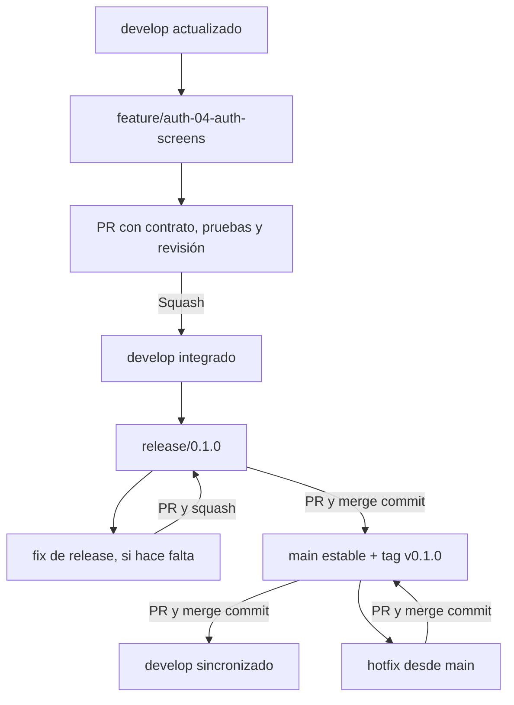

# DevPath: ramas, commits, PRs y colaboración con IAs

Este flujo es una propuesta concreta basada en la preferencia del equipo: cada feature nace de `develop`, se revisa y vuelve a `develop`. Está adaptado a dos personas programando, tres contribuyendo contenido/documentación/aceptación y una aplicación local sin despliegue obligatorio.

Ver [plan técnico](PLAN_DE_IMPLEMENTACION.md), [backlog de 50 tareas](TAREAS_PARA_IAS.md) e [índice de lotes con prompts](LOTES_PARA_IAS.md). Los comandos son instrucciones para la implementación futura; redactar este plan no crea ramas, commits, PRs ni configuraciones remotas.

## 1. Ramas y significado

| Rama | Nace de | PR hacia | Uso | Merge |
| --- | --- | --- | --- | --- |
| main | Bootstrap inicial | — | Última versión estable demostrable | Recibe merge commits de release/hotfix. |
| develop | main inicial | — | Integración del hito activo | Recibe features por squash y sincronización desde main por merge commit. |
| feature/ID-descripcion | develop actualizado | develop | Cambio de comportamiento | Squash. |
| fix/ID-descripcion | develop actualizado | develop | Defecto durante desarrollo | Squash. |
| test/ID-descripcion | develop actualizado | develop | Pruebas automáticas independientes | Squash. |
| data/ID-descripcion | develop actualizado | develop | Catálogo, corpus o plantillas | Squash. |
| docs/ID-descripcion | develop actualizado | develop | Documentación y aceptación manual | Squash. |
| chore/ID-descripcion | develop actualizado | develop | Tooling, dependencias y configuración | Squash. |
| release/X.Y.Z | develop en el corte | main | Estabilizar y publicar una entrega | Merge commit. |
| fix/ID-release-descripcion | release/X.Y.Z | release/X.Y.Z | Corrección durante congelamiento | Squash. |
| hotfix/ID-descripcion | main actualizado | main | Corregir una versión estable ya publicada | Merge commit; luego sincronizar main a develop. |

Los IDs se escriben en minúscula dentro del nombre de rama: `feature/auth-04-auth-screens`. El ID del backlog y el número de issue de GitHub son identificadores distintos; la issue debe contener ambos.

No crear ramas permanentes frontend/backend ni una rama compartida para cada persona. Cada tarea crea una rama de vida corta. Esto permite revisar una contribución sin arrastrar cambios ajenos.

## 2. Diagrama del recorrido



Una release no crea una nueva línea de features; es un corte estable del trabajo ya integrado. Mientras se estabiliza, se congela el merge de nuevas features en develop para simplificar la operación del equipo.

## 3. Arranque: reutilizar el historial existente

### 3.1 Inspección antes de escribir historial

La inspección inicial del 30 de octubre no encontró historial; la revisión del 31 de octubre sí observa `c338a21` (`FIRTS STEPS`) en main y la referencia local origin/main. No se encontró develop local. GOV-02 reutiliza ese commit y verifica remoto/refs antes de establecer develop. No repetir un primer commit ni reinicializar este repositorio.

GOV-02 debe comprobar, desde el repositorio correcto:

```powershell
git status --short --branch
git branch --all
git ls-remote --heads origin
```

Si origin no existe o no apunta al repositorio del equipo, configurarlo con la URL acordada. No copiar una URL que contenga credenciales en documentos o capturas.

Si el remoto ya tiene commits, traerlo y reconciliar la base antes de continuar. No crear un historial incompatible ni usar force push para sobrescribirlo. La receta siguiente solo corresponde al caso de repositorio remoto sin historial que se confirme.

### 3.2 Caso actual: crear develop sin repetir el primer commit

Si después de verificar el remoto develop no existe y main es la base válida, crear develop desde esa main y publicarla mediante la cuenta autorizada. Si ya existe en remoto, descargarla y seguirla. El resto de GOV-02 se entrega por PR normal; STR-01 preparado por el lote 00 se integra por su propio PR antes de FND-01. Conservar cambios locales sin incluirlos accidentalmente en otra tarea.

### 3.3 Receta histórica: solo para un repositorio sin commits

P4 prepara los archivos de GOV-01/GOV-02, revisados por P1/P2: README, descripción, planes, decisiones, ignores, atributos y plantillas. Antes de hacer commit, verificar que no se hayan incluido env, llaves, archivos personales, node_modules ni volúmenes.

Ejemplo de comandos una vez que esos archivos existen:

```powershell
git add -- "DevPath_Project_Description.md" "README.md" ".gitignore" ".gitattributes" "docs" ".github"
git diff --cached
git commit -m "chore(repo): bootstrap DevPath planning and collaboration"
git push -u origin main
git switch -c develop
git push -u origin develop
```

Este primer commit es la excepción al trabajo mediante PR porque aún no existe una base desde la cual abrirlo. No incluye implementación de auth ni otras features. Después, proteger main/develop según las capacidades del repositorio.

Si GOV-01 ya quedó incluido en este commit inicial, registrar esa evidencia en su issue y no abrir un PR vacío solo para generar otro commit.

## 4. Recorrido normal de una tarea

### 4.1 Antes de crear la rama

1. Elegir una issue Ready del hito activo.
2. Comprobar que las dependencias están integradas en develop.
3. Leer el contrato y la lista de archivos permitidos.
4. Asignar responsable, revisor y rama.
5. Trabajar con árbol limpio o en un worktree exclusivo. No apartar o modificar cambios ajenos.

### 4.2 Ejemplo: pantalla de login

AUTH-04 depende de AUTH-03. El backend de AUTH-01/AUTH-02 ya debe estar integrado. Este ejemplo implementa formulario/rutas; no cambia las cookies ni inventa otros endpoints.

En el clon personal del responsable:

```powershell
git fetch origin
git switch develop
git pull --ff-only origin develop
git switch -c feature/auth-04-auth-screens
```

El responsable implementa y valida. Una vez que existan los scripts de FND-01, ejecuta los controles aplicables; los filtros por paquete se documentarán con sus nombres reales.

```powershell
pnpm lint
pnpm typecheck
pnpm test
pnpm build
git diff
git status --short
git add -- "apps/web/src/features/auth" "apps/web/src/app"
git diff --cached
git commit -m "feat(auth): connect login and registration screens"
git push -u origin feature/auth-04-auth-screens
```

Los paths del ejemplo deben corresponder al diff real; no agregar directorios completos si contienen trabajo ajeno. Si requiere cambiar archivos fuera del alcance, coordinar antes con su propietario.

En GitHub:

1. Crear PR con **base: develop** y **compare: feature/auth-04-auth-screens**.
2. Enlazar issue AUTH-04 y explicar qué comportamiento quedó conectado.
3. Incluir validación real, captura pertinente y limitaciones.
4. P1 revisa el contrato, manejo de errores y sesión; P5 puede revisar uso/teclado.
5. Corregir comentarios en la misma rama y esperar CI.
6. El integrador hace **Squash and merge**.
7. Cerrar issue y borrar únicamente la rama de tarea ya integrada.

El PR de AUTH-01 se hace del mismo modo con `feature/auth-01-register-login`, también desde develop y hacia develop. Backend y frontend no se unen directamente entre sí: se encuentran a través de develop y del contrato compartido.

### 4.3 Mantener una feature actualizada

Usar merge de develop hacia la rama de tarea evita reescribir historial que otra persona o IA esté usando:

```powershell
git fetch origin
git switch feature/auth-04-auth-screens
git merge origin/develop
```

Si hay conflictos, resolverlos entendiendo ambas intenciones, volver a validar y subir la rama. No reemplazar todos los archivos con “ours” o “theirs” ni descartar migraciones de otra tarea.

Cuando termine:

```powershell
git push origin feature/auth-04-auth-screens
```

No se requiere force push. Si una rama privada se rebasa excepcionalmente, el dueño debe coordinarlo y usar las protecciones apropiadas; el procedimiento habitual de este proyecto es merge.

Una rama squasheada no se reutiliza. La siguiente tarea nace de un develop actualizado. Si Git se niega a borrar una rama local por no reconocer el squash como ancestro, no forzar el borrado como parte de una limpieza automática; verificar primero el PR y conservarla si hay duda.

## 5. PR y commits

### 5.1 Tamaño y contenido

Una tarea por PR. Preferir un resultado acotado y demostrable; separar un refactor grande de una feature si dificulta la revisión.

Tipos sugeridos de commit:

- `feat(auth): rotate refresh sessions atomically`.
- `fix(analysis): preserve null score without detected skills`.
- `test(auth): cover refresh token reuse`.
- `docs(setup): verify Windows local installation`.
- `data(catalog): distinguish Java and JavaScript aliases`.
- `chore(ci): run required checks on pull requests`.

El squash final resume la tarea; los commits de trabajo pueden reflejar iteraciones reales. No exigir un número de commits por participante ni dividir cambios artificialmente para inflar contribuciones.

### 5.2 Cuerpo mínimo del PR

```text
Problema y resultado
<qué podía hacer el usuario antes y qué puede hacer ahora>

Issue y alcance
<ID del backlog; Closes #numero-real; qué entrega cubre>

Conexiones y contrato
<endpoint/DTO/tabla/pantalla afectada; versión de contrato>

Validación
<comandos y casos ejecutados, con resultados reales>

Limitaciones o decisiones
<solo lo que afecte revisión o uso>
```

Los cambios de pantalla agregan una captura o grabación breve si ayuda. Los de catálogo incluyen casos de entrada/salida. Los de docs incluyen quién reprodujo las instrucciones. No se suben tokens ni información de una cuenta real.

Si se usa CLI para crear el PR, guardar el cuerpo exacto en un archivo temporal y usar `--body-file`; no construir cuerpos multilínea con escapes que terminen apareciendo como texto literal.

### 5.3 Revisión

- P1 y P2 se revisan mutuamente el código.
- P1/P2 revisan cualquier catálogo o contrato que vaya a consumir código.
- P3 revisa contenido de learning paths; P4 coherencia documental; P5 estados de pantalla y evidencia.
- Un aprobador humano distinto del autor es el objetivo. Si una persona trabaja sola temporalmente, registrar la revisión pendiente; no fingir una aprobación.
- CI verde demuestra solo lo que se ejecutó; la aceptación manual debe tener evidencia propia.

## 6. Publicar una entrega estable sin desplegar

### 6.1 Corte de release

Ejemplo para M1, después de cerrar los criterios de REL-01:

```powershell
git fetch origin
git switch develop
git pull --ff-only origin develop
git switch -c release/0.1.0
git push -u origin release/0.1.0
```

En la release se actualizan versión/changelog mediante un commit revisado y se ejecutan controles. El changelog forma parte del árbol del repositorio, no solo de la descripción del PR; eso también permite verificar qué versión se está probando.

Congelar nuevas features en develop hasta sincronizar el cierre. Las siguientes tareas pueden prepararse en ramas propias, sin integrarlas durante el congelamiento.

### 6.2 Corregir durante la estabilización

Un defecto de release nace de esa release, no de main ni del develop que podría cambiar:

```powershell
git fetch origin
git switch -c fix/bug-017-release-session origin/release/0.1.0
```

El nombre BUG-017 es ilustrativo y debe reemplazarse por la issue real. Crear PR hacia `release/0.1.0`, revisar, ejecutar CI y hacer squash. No mergear la corrección por separado a develop durante el congelamiento: entrará con la sincronización completa de main al terminar.

### 6.3 PR a main y tag

Crear PR **release/0.1.0 → main** con:

- Alcance de M1 y criterios aceptados.
- Validación desde el commit candidato.
- Migraciones y cambios de configuración.
- Limitaciones conocidas y modo de ejecución local.

Hacer **Create a merge commit**. No usar squash para release → main: conservar la ascendencia facilita sincronizar ramas de larga duración. GitHub permite configurar estrategias de merge; el motivo de elegirlas aquí es una política del proyecto. Referencia: [Pull request merges](https://docs.github.com/en/pull-requests/reference/pull-request-merges).

Después del merge, el integrador actualiza su main y etiqueta el commit publicado:

```powershell
git fetch origin
git switch main
git pull --ff-only origin main
git tag -a v0.1.0 -m "DevPath v0.1.0 - manual skill analysis"
git push origin v0.1.0
```

Confirmar que HEAD es el merge de esa release antes del tag. Si main avanzó por otra corrección, etiquetar el SHA exacto previsto. No mover ni reutilizar tags ya publicados; una corrección produce otra versión.

Publicar una versión de Git no significa desplegar en Internet.

### 6.4 Sincronizar main a develop

Abrir PR **main → develop**, revisar y usar **Create a merge commit**. Esto incorpora versión, changelog y fixes de estabilización manteniendo ancestros comunes.

Tras el merge:

```powershell
git fetch origin
git switch develop
git pull --ff-only origin develop
```

Verificar que develop contiene main, levantar la app y cerrar REL-01. Solo entonces reabrir integración de la siguiente entrega y borrar la rama release. La sincronización no se hace mediante squash ni cherry-picks de todos los commits.

M2, M3 y M4 repiten el proceso con 0.2.0, 0.3.0 y 0.4.0.

## 7. Hotfix de una versión estable

Aunque no haya producción, una demo estable puede necesitar una corrección sin arrastrar features incompletas de develop.

1. Crear issue que describa el defecto sobre el tag estable.
2. Crear `hotfix/ID-descripcion` desde `origin/main`.
3. Corregir, probar y actualizar versión/changelog de parche.
4. PR hotfix → main con merge commit y revisión.
5. Etiquetar el nuevo commit, por ejemplo `v0.1.1`.
6. PR main → develop con merge commit y validación.
7. Si hay una release abierta, incorporar también main en esa release mediante PR revisado y resolver conflictos.
8. Cerrar el hotfix después de comprobar propagación.

No crear el hotfix desde develop si eso llevaría trabajo no estabilizado a main.

Un bug descubierto antes de publicar la primera versión es un `fix/*` de desarrollo, no un hotfix.

## 8. Protección de ramas y CI

GOV-02/CI-01 verifican primero las funciones disponibles según visibilidad, plan y permisos de GitHub. No se asume que todas las reglas puedan activarse en cualquier cuenta.

Configuración propuesta para main y develop:

- Require pull request antes de merge.
- Una aprobación humana, distinta del autor.
- Resolver conversaciones antes de merge.
- Checks requeridos y base actualizada.
- Prohibir force push y borrado.
- Evitar bypass administrativo en uso normal.

Checks esperados:

| Check | Qué debe comprobar |
| --- | --- |
| lint | Estilo y reglas relevantes. |
| typecheck | Contratos y TypeScript de todos los paquetes activos. |
| contracts-data | OpenAPI/ejemplos, catálogo y corpus válidos. |
| unit-integration | Dominio y HTTP/DB aislados. |
| build | Artefactos compilables. |
| e2e | Recorrido real cuando se integre QAA-01. |
| ci-gate | Resultado agregado que se ejecuta siempre y decide el estado requerido. |

Al inicio solo se exigen checks que ya existan y hayan corrido. El agregado incorpora nuevas pruebas con su tarea; no obliga a un job ausente que impediría todos los merges.

CI cubre PRs hacia main, develop y `release/**`. Push a main/develop puede volver a comprobar el estado integrado. Los checks no se llaman igual entre workflows distintos para evitar ambigüedad.

Permitir a nivel repositorio squash y merge commits, pero **no activar Require linear history**: esta política necesita merges de dos padres para release/sincronización. Cada PR usa la estrategia de la tabla.

Una validación puede comprobar que main solo reciba release/hotfix y develop reciba features o sincronización desde main. Implementarla sin interpolar nombres de rama no confiables como comandos shell.

GitHub documenta los requisitos y limitaciones en [About protected branches](https://docs.github.com/en/repositories/configuring-branches-and-merges-in-your-repository/managing-protected-branches/about-protected-branches). La combinación concreta anterior es la política propuesta del equipo.

Para workflows: permisos mínimos, versiones de acciones fijadas y ningún código de PR no confiable ejecutado con secretos privilegiados. Referencia: [GitHub Actions secure use](https://docs.github.com/en/actions/reference/security/secure-use).

Si una regla no está disponible, registrar la limitación y aplicar el mismo criterio manual mediante PR y revisor; no afirmar que hay protección técnica activa. No habilitar eliminación automática de ramas si pudiera afectar main/develop; borrar ramas cortas de forma selectiva.

## 9. Trabajo paralelo con varias IAs

### 9.1 Personas en computadoras distintas

Cada persona usa su propio clon y cuenta de GitHub. No comparten credenciales. Antes de cada tarea hacen fetch y crean su rama desde develop actualizado.

Las contribuciones de documentación/catálogo/QA usan el mismo flujo de revisión que el código. Un PR de evidencia es una contribución válida cuando contiene pruebas realizadas y conclusiones reproducibles.

### 9.2 Varias IAs en la misma computadora

No permitir que dos IAs hagan `git switch` en la misma carpeta. Cada tarea necesita un worktree y rama exclusiva, o un clon separado.

Ejemplo desde el repositorio principal, después del bootstrap y con `.worktrees/` en .gitignore:

```powershell
git fetch origin
git worktree add -b feature/auth-01-register-login .worktrees/auth-01 origin/develop
git worktree add -b feature/web-01-app-shell .worktrees/web-01 origin/develop
git worktree list
```

Asignar a cada IA su ruta exacta. Ese ejemplo solo se usa si las ramas no existen ya y sus dependencias están listas; no crea dos versiones de una misma tarea.

Cada worktree necesita dependencias instaladas y recursos de prueba aislados. No apuntar tests de dos tareas a la misma DB mutable. Usar DB/puertos o proyectos Compose distintos con nombres por tarea, y no reutilizar el volumen de datos de la demo como DB de prueba.

El integrador mantiene una tabla:

| Tarea | Persona/IA | Rama | Carpeta | Archivos compartidos reservados | Estado |
| --- | --- | --- | --- | --- | --- |
| AUTH-01 | P1 / IA asignada | feature/auth-01-register-login | .worktrees/auth-01 | módulo auth | Ready/In progress |
| WEB-01 | P2 / IA asignada | feature/web-01-app-shell | .worktrees/web-01 | app/router/components | Ready/In progress |

No se reserva una rama compartida para que varias IAs vayan pisándose cambios. Después del merge, conservar el worktree hasta confirmar diff limpio y publicación de commits; `git worktree remove <ruta>` sin force puede retirarlo de forma segura cuando ya no se usa.

### 9.3 Propiedad de archivos compartidos

| Archivo/zona | Responsable de coordinar | Regla |
| --- | --- | --- |
| OpenAPI y ejemplos | P4 con revisión P1/P2 | Cambio de contrato antes o junto al cambio de consumidores. |
| Migraciones/schema | P1 | Una secuencia coherente; nunca editar migración aplicada. |
| pnpm-lock.yaml y manifiestos raíz | P2 | Serializar altas de dependencia y regenerar con la versión fijada. |
| Catálogo/plantillas/corpus | P3 con P2/P1 | Versionar contenido y revisar impacto en resultados. |
| Router y providers de web | P2 | Integrar entradas de features con cuidado. |
| Compose/proxy/CI | P2 con P1 | Cambios de configuración visibles para todos. |
| Resultados de aceptación | P5 | Evidencia ligada al commit realmente probado. |

El responsable no tiene exclusividad absoluta sobre todo el trabajo, sino la obligación de coordinar cambios concurrentes y revisar compatibilidad.

## 10. Resolver conflictos y cambios de contrato

### 10.1 Contratos

1. Abrir una propuesta concreta: problema, DTO actual y DTO propuesto.
2. P1/P2 revisan impacto en API, web, engine y datos.
3. P4 actualiza especificación y ejemplos.
4. Integrar contrato compatible y después consumidores, o un PR atómico si el cambio rompe el hito aún no publicado.
5. Añadir prueba de integración que ejercite el comportamiento afectado.
6. Actualizar el backlog si cambian dependencias.

No se acepta que el frontend “arregle” un error esperando un campo distinto al contrato mientras el backend sigue enviando el anterior.

### 10.2 Migraciones y catálogo

- Nueva migración para cada cambio aplicado; probar desde vacío y desde la versión anterior.
- Evitar renumerar historia ya integrada. Resolver colisiones mediante nueva migración revisada.
- Catálogo con IDs estables; no regenerar IDs al ordenar el JSON.
- Una actualización de alias puede cambiar el análisis: incrementar versión y no reescribir resultados históricos.
- Si API y engine tienen distinta versión de catálogo, rechazar de forma explícita hasta alinearlos.

### 10.3 Lockfile

Después de integrar cambios de manifiesto, P2 regenera el lockfile con la herramienta/version fijada y ejecuta instalación limpia. No resolver un conflicto borrándolo sin entender dependencias, ni aceptar una mitad del conflicto arbitrariamente.

## 11. Revertir cambios y recuperar una versión

- Antes de merge: corregir la rama o cerrar el PR; no tocar main/develop para “limpiar”.
- Feature squasheada defectuosa: crear fix desde develop o PR de revert del commit concreto.
- Release defectuosa: hotfix o PR de revert revisado; no mover el tag ni reescribir main.
- Revertir código no revierte automáticamente la DB. Si la migración cambió datos, preparar una migración de corrección o una restauración local explícita, con respaldo cuando corresponda.
- No usar `git reset --hard` ni force push sobre ramas compartidas.
- Los comandos para borrar volúmenes o archivos CV nunca forman parte del arranque normal.

Un tag estable y sus instrucciones permiten volver a demostrar una versión. Los datos de esa versión también necesitan una estructura compatible; esa comprobación pertenece al release.

## 12. Checklist para el integrador

Antes de integrar una tarea:

- Base y destino correctos; dependencias integradas.
- Diff limitado al alcance y sin secretos.
- Contrato y migraciones revisados.
- Checks requeridos en verde y revisión de otra persona.
- Resultado observable y evidencia honesta.
- Issue enlazada y siguiente tarea liberada después del merge.

Antes de cerrar release:

- Criterios del hito aceptados, bloqueantes resueltos y limitaciones claras.
- Setup y migración desde versión anterior verificados.
- Versión/changelog actualizados en el repositorio.
- Merge commit a main y tag sobre el commit correcto.
- Merge commit de main a develop y smoke test.
- Ningún despliegue o gasto requerido para considerar estable la entrega local.

## 13. Ejecución mediante lotes de IA

El [índice de lotes](LOTES_PARA_IAS.md) organiza STR-01 en un lote 00 y las 49 tareas originales en diez lotes: nueve de cinco y uno de cuatro. La misma IA puede retomar un lote después de los merges humanos necesarios.

Un lote no es una rama ni un PR de cinco features. Cada tarea conserva su rama y revisor. Después de cada merge, actualizar develop antes de la siguiente tarea. Si el merge aún no existe, registrar handoff y continuar únicamente otra tarea Ready independiente del mismo lote.

Si varias personas participan en un lote, cada una aporta y revisa su parte real con su cuenta; no cambiar el autor de commits para atribuir trabajo ficticio. Las IAs no aprueban PRs en nombre de personas ni publican tags automáticamente.

El lote 00 prepara la estructura completa, incluso carpetas reservadas de etapas futuras. No crea manifiestos o configuraciones vacías que aparenten un workspace funcional: FND-01 implementa esa parte tras el PR de STR-01.
