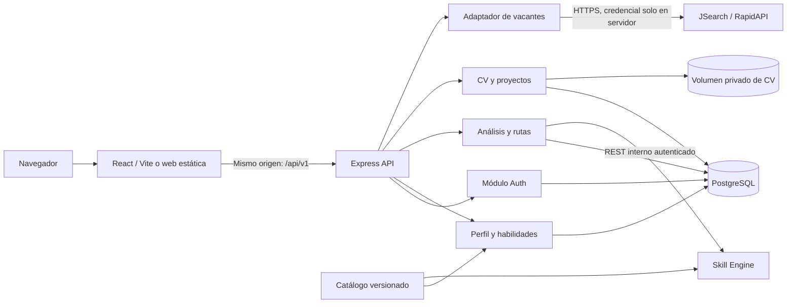
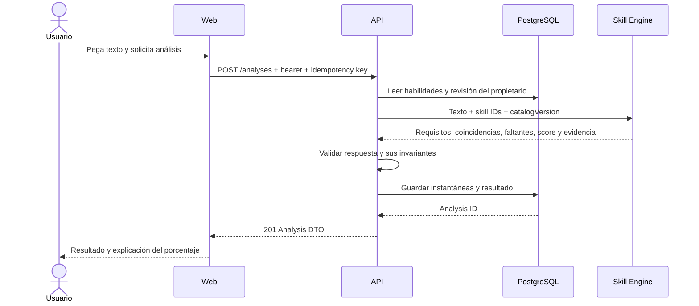
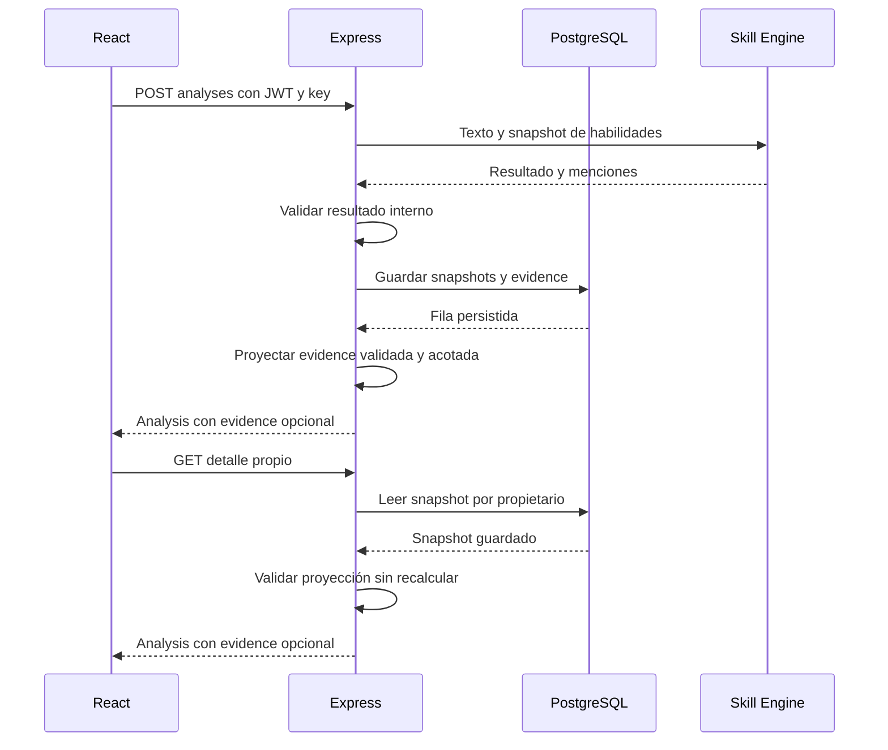

# DevPath: plan de implementación y conexión de componentes

Fecha de referencia: 30 de octubre de 2026. Actualización de lotes y estado Git: 31 de octubre de 2026. Estado: planificación; no hay aplicación implementada.

Este plan se basa en [la descripción del proyecto](../DevPath_Project_Description.md), en la inspección del repositorio y en las respuestas del equipo. El documento original se conserva como fuente; sus ejemplos y su sección de instrucciones para otra IA se tratan como contexto, no como decisiones ya aprobadas.

Documentos de trabajo:

- [Lotes de hasta cinco tareas y prompts listos para copiar](LOTES_PARA_IAS.md).
- [Tareas delegables, responsables y dependencias](TAREAS_PARA_IAS.md).
- [Ramas, commits, pull requests y releases](FLUJO_GITHUB.md).

## 1. Decisiones confirmadas y propuestas

### 1.1 Confirmado por el equipo

- Participarán cinco personas haciendo contribuciones al repositorio.
- Dos personas concentrarán la implementación de código.
- Las otras tres necesitan tareas acotadas y útiles que puedan entregar mediante commits y PRs.
- No se necesita un calendario ni fechas de entrega.
- La primera entrega incluirá perfil y análisis de texto, con la autenticación y las habilidades necesarias para usarlos.
- CV, búsqueda mediante JSearch y rutas de aprendizaje se incorporarán después.
- El análisis comenzará con reglas y un catálogo de tecnologías; no se requiere IA generativa.
- El objetivo es ejecutar el proyecto localmente. Se deja abierta una alternativa de despliegue con presupuesto de cero pesos.
- React + Vite, Node.js + Express, PostgreSQL y GitHub constituyen la base descrita en el proyecto.

### 1.2 Propuestas técnicas de este plan

Son decisiones recomendadas para que las tareas tengan una base común. Pueden cambiarse mediante una decisión documentada antes de implementar el módulo afectado.

| Decisión | Propuesta | Consecuencia |
| --- | --- | --- |
| Organización | Monorepo con pnpm workspaces y TypeScript | Un solo repositorio, versiones y comandos compartidos. |
| Backend principal | Express con módulos de auth, perfil, catálogo, análisis, archivos, vacantes y rutas | Las rutas HTTP delegan a servicios de dominio; los controladores no concentran SQL ni lógica. |
| Autenticación | Módulo propio dentro del backend principal en las primeras entregas | Conserva contratos separados de auth sin mantener otro proceso distribuido. |
| Skill Engine | Servicio REST independiente, también en TypeScript | Mantiene el microservicio de matching descrito en la fuente y permite probarlo por separado. |
| Persistencia | PostgreSQL, Drizzle + pg y migraciones SQL versionadas | Los cambios de estructura son revisables y repetibles. |
| Validación | Esquemas Zod y contratos OpenAPI versionados | TypeScript ayuda al desarrollo; los límites HTTP se validan en ejecución. |
| Frontend | React Router, TanStack Query y estado de sesión en memoria | Rutas de pantalla, caché de datos del servidor y autenticación tienen responsabilidades concretas. |
| Presentación | CSS y componentes compartidos, paleta rosa suave, interfaz inicial en español | Evita introducir un sistema visual complejo antes de completar el flujo. |
| Pruebas | Vitest, pruebas HTTP y PostgreSQL real de prueba; Playwright para recorridos críticos | Las pruebas de integración verifican comportamiento real entre capas. |
| Ejecución | Desarrollo con Vite y servicios locales; Docker Compose para la demostración completa | No depende de contratar hosting. |
| Versiones | Versiones estables compatibles, fijadas durante FND-01 en manifiestos y lockfile | No usar etiquetas flotantes como `latest` en la configuración entregada. |

La fuente deja abierta la separación física de auth. Aquí se recomienda integrarlo como módulo por el tamaño del equipo. Esto es una simplificación propuesta, no una afirmación de que el documento exigía esa topología. Si se exige un microservicio de auth independiente, resolverlo en GOV-01 antes de FND-01: conservar las rutas, separar credenciales y sesiones, y rediseñar el alta de perfil y el borrado de cuentas sin transacciones entre procesos.

Referencias de las herramientas propuestas: [pnpm workspaces](https://pnpm.io/workspaces), [Drizzle](https://orm.drizzle.team/docs/sql-schema-declaration), [Zod](https://zod.dev/), [React Router](https://reactrouter.com/start/declarative/installation), [TanStack Query](https://tanstack.com/query/latest/docs/framework/react/overview), [Vitest](https://vitest.dev/guide/) y [Playwright](https://playwright.dev/docs/intro). La selección y la organización de módulos son propuestas propias de este plan.

### 1.3 Estado real del repositorio

La inspección inicial del 30 de octubre encontró solo la descripción y ningún commit. La revisión del 31 de octubre ya encuentra el commit `c338a21` (`FIRTS STEPS`), con `main` y la referencia local `origin/main` apuntando a él, además de los tres documentos de planificación. No se encontró una rama `develop` local ni su referencia remota descargada. Esto no verifica por sí solo el estado actual del servidor remoto. No se verificó el tag `e3-microservice`.

GOV-02 debe reutilizar ese historial, comprobar las refs y establecer `develop` cuando falte. No repetir el primer commit ni reinicializar el repositorio. La receta sin historial del flujo Git solo corresponde a un repositorio realmente nuevo.

## 2. Entregas y límites de alcance

| Entrega | Resultado demostrable | Incluye | Condición para cerrarla |
| --- | --- | --- | --- |
| M0: base | Otra persona puede levantar la estructura y ejecutar los controles | Repositorio, contratos, catálogo inicial, DB, esqueletos, CI | Instrucciones verificadas desde una copia limpia. |
| M1 / v0.1.0 | Una persona se registra, edita su perfil y compara habilidades con una vacante pegada | Auth, perfil, catálogo, habilidades, matching, análisis guardados e historial básico | Recorrido real navegador → API → engine → DB; privacidad entre dos cuentas. |
| M2 / v0.2.0 | La persona completa su contexto profesional | Proyectos y un CV privado PDF | Subir, sustituir, descargar y borrar el CV; proyectos con control de propietario. |
| M3 / v0.3.0 | La persona busca una vacante real y la analiza | Adaptador JSearch, búsqueda, detalle y selección | Términos y cuotas verificados, secretos en servidor, fallos del proveedor controlados. |
| M4 / v0.4.0 | Un análisis genera un plan explicable y permite registrar avance | Plantillas curadas, proyectos, prerequisitos, rutas y progreso manual | El resultado es reproducible y queda persistido con sus versiones. |

Cada entrega se integra en `develop` y se publica como versión estable local en `main` mediante PR de release. Las etapas siguientes pueden tener contratos preparados antes, pero no bloquean M1.

Fuera de estas entregas: portales de empleadores, solicitudes de empleo dentro de DevPath, pagos, chat, scraping propio, login social, extracción automática del CV, LLMs, recomendaciones comerciales y certificación de habilidades. Recuperación de contraseña, verificación de email y operación pública se evalúan en el anexo de despliegue; no forman parte de la demo local inicial.

## 3. Personas, responsabilidades y contribuciones

Los identificadores P1–P5 son roles operativos estables. Las issues y los PR asignan uno de estos roles sin exigir nombres personales ni usernames.

| Persona | Responsabilidad principal | Ejemplos de contribuciones reales |
| --- | --- | --- |
| P1 | Backend y datos | Auth, migraciones, permisos, APIs de perfil, análisis, CV y proveedor. |
| P2 | Frontend e integración técnica | Pantallas, cliente HTTP, sesión, engine, Compose, CI y pruebas de recorridos. |
| P3 | Catálogo y contenido verificable | Alias de tecnologías, corpus etiquetado, prerequisitos y plantillas de aprendizaje. |
| P4 | Documentación técnica y coordinación | Contratos OpenAPI revisados con P1/P2, decisiones, guía de instalación y normas Git. |
| P5 | Aceptación, experiencia y evidencias | Casos manuales, revisión de estados de pantalla, teclado, contraste e informes de incidencias. |

Una persona puede usar otra IA para preparar su tarea. Sigue siendo responsable de comprender el cambio, ejecutar su validación y revisar el diff. Los commits deben reflejar trabajo realizado; no se propone repartir autorías ficticias ni cambios sin propósito. Los tres participantes con menos código pueden completar PRs independientes con datos, documentación y evidencia.

P1 revisa cambios de engine/infraestructura de P2; P2 revisa los cambios de backend de P1. P3/P4/P5 aportan revisión de su especialidad. El autor de un PR no se cuenta como su propio aprobador.

## 4. Arquitectura y conexiones

### 4.1 Vista de ejecución



El navegador se comunica únicamente con la API pública de DevPath. No llama al engine, PostgreSQL, almacenamiento de CV ni JSearch. La API obtiene las habilidades del propietario autenticado y entrega al engine solo los datos necesarios para comparar.

Cambio deliberado respecto al diagrama conceptual original: JSearch queda en un adaptador del backend principal. El engine se dedica a extraer tecnologías y calcular coincidencias. Así puede funcionar con texto manual sin credenciales externas, sin conocer al usuario y sin depender de Internet.

### 4.2 Matriz de conexiones

| Origen → destino | Dirección o interfaz | Autenticación | Datos que cruzan | Fallo y responsable |
| --- | --- | --- | --- | --- |
| Web → API auth | `/api/v1/auth/*` | Credenciales en login; refresh en cookie | Nombre/email/contraseña o cookie; access token en respuesta | Cliente de sesión: 401, 429, 503. |
| Web → API de negocio | `/api/v1/*` | `Authorization: Bearer` | Perfil, IDs de skills, texto, proyectos y comandos | Cliente HTTP y pantalla consumidora. |
| API → PostgreSQL | Conexión de servidor con pool | Usuario de DB con permisos acotados | Registros y transacciones parametrizadas | Repositorios; 503 seguro al cliente. |
| API → engine | `POST /internal/v1/analyze` | Credencial de servicio independiente | Texto, skill IDs y versión de catálogo | Adaptador de engine; tiempo límite y validación de respuesta. |
| API → JSearch | Endpoints verificados del proveedor | RapidAPI key y host | Consulta de empleo o ID del proveedor | Adaptador JSearch; no propagar errores crudos. |
| API → almacenamiento | Interfaz `CvStorage` | Permisos del proceso | Archivo privado con identificador generado | Servicio CV; compensación y limpieza. |
| Web → descarga CV | `GET /api/v1/me/cv/download` | Bearer mediante `fetch` | Bytes del PDF del propio usuario | Pantalla perfil descarga un Blob; no token en URL. |

No hay llamadas del engine hacia la DB. No se acepta `X-User-Id` del navegador como identidad. La identidad de negocio siempre proviene del JWT verificado.

### 4.3 Dos modos locales

**Desarrollo:** web en `http://localhost:5173`; Vite reenvía `/api` al backend en 3000. API y engine pueden escuchar en 127.0.0.1:3000 y 127.0.0.1:3001. PostgreSQL se levanta con Compose. El navegador siempre usa URLs relativas `/api/v1`; no concatena puertos por pantalla.

**Demostración reproducible:** `docker compose up --build` publica la web y el proxy en `http://localhost:8080`. El proxy sirve React y reenvía `/api` al backend. API, engine, DB y volumen de CV están en la red interna de Compose. Se publican puertos de DB únicamente en un perfil de desarrollo, ligados a loopback.

En ambos casos, una recarga de `/profile` debe devolver la SPA, mientras que una ruta inexistente `/api/*` devuelve un error JSON, no el HTML de React. Las rutas `/internal/*` del engine no se publican en el proxy.

## 5. Estructura propuesta del repositorio

```text
apps/
  web/src/
    app/                  # router, providers, layout
    features/
      auth/ profile/ skills/ analyses/
      projects/ cv/ jobs/ learning-paths/
    lib/http/             # fetch, errores, renovación, request IDs
    components/           # botones, formularios, estados, navegación
  api/src/
    app.ts                # construir app sin abrir puerto; pruebas HTTP
    server.ts             # escuchar, señales y cierre ordenado
    modules/
      auth/ profile/ skills/ analyses/
      projects/ cv/ jobs/ learning-paths/
    platform/             # configuración, DB, logs, permisos, HTTP
  skill-engine/src/
    app.ts
    server.ts
    modules/analysis/     # extracción y matching
packages/
  contracts/
    openapi/public.yaml
    openapi/engine.yaml
    src/                  # validadores y tipos derivados
    examples/             # cuerpos válidos y errores
  catalog/
    technologies.json
    learning-templates.json
    fixtures/             # textos sintéticos y etiquetas esperadas
  db/
    schema/
    migrations/
    seeds/
  test-support/           # factories y utilidades solo de prueba
infra/
  compose.yaml
  proxy/
docs/
  adr/
  acceptance/
  provider/
  PLAN_DE_IMPLEMENTACION.md
  TAREAS_PARA_IAS.md
  FLUJO_GITHUB.md
.github/
  workflows/
  ISSUE_TEMPLATE/
  pull_request_template.md
```

El usuario solicita ahora una IA dedicada al árbol completo. STR-01 / lote 00 reserva desde el inicio las carpetas de M0–M4, con `.gitkeep` en hojas vacías y README de responsabilidad. Las carpetas futuras no contienen implementación ficticia. FND-01 añade después manifiestos, herramientas y arranque real de M0 sobre ese árbol. El prompt de estructura es [00-estructura-completa.md](prompts/lotes/00-estructura-completa.md); preparar el prompt no equivale a haber ejecutado su creación de carpetas.

Reglas de importación:

- Web puede importar contratos públicos y datos públicos del catálogo, nunca código de DB ni módulos de API.
- API puede importar contratos, catálogo y DB.
- Engine puede importar contratos internos y catálogo; no el cliente de DB ni auth.
- No crear un paquete genérico `shared` para mover allí toda la lógica.
- No duplicar DTOs a mano por pantalla. El contrato HTTP y sus ejemplos alimentan mocks, validación y documentación.
- P4 mantiene OpenAPI; P1/P2 revisan que los validadores de ejecución y los tipos coincidan. CI valida ejemplos y detecta divergencias. La tarea CTR-01 elegirá y documentará una sola dirección de generación entre esquemas y OpenAPI.

## 6. Contratos públicos

### 6.1 Convenciones

- Prefijo público `/api/v1`; JSON salvo carga/descarga de CV.
- UUID para cuentas, proyectos, análisis y rutas; skill IDs estables de texto, por ejemplo `react`, `javascript`, `nodejs`.
- Fechas UTC en ISO 8601; interfaz puede mostrarlas en la zona local.
- Rechazar campos inesperados en comandos sensibles; aplicar límites de longitud y tamaño.
- Recurso ajeno: 404 para evitar confirmar su existencia. Sin autenticación: 401. Operación no permitida para una identidad válida: 403.
- No enviar hashes, rutas físicas, trazas de error, llaves, refresh tokens ni cuerpos del proveedor sin normalizar.
- Listas propias: `limit` predeterminado 20 y máximo 50; cursor opaco basado en `created_at,id`.
- El esquema de jobs usa la paginación real del proveedor, mapeada explícitamente en JSR-01; no inventar un total de resultados.
- `X-Request-Id` se genera en la API y viaja al engine. Valores entrantes solo se aceptan si se validan.
- Las mutaciones muestran estado pendiente, impiden doble envío y conservan el formulario cuando hay error.

Error público:

```json
{
  "error": {
    "code": "VALIDATION_ERROR",
    "message": "Revisa los datos enviados.",
    "requestId": "7bfb5328-6b03-4ff8-91e8-a285f31add47",
    "fields": {
      "email": ["Introduce un correo válido."]
    }
  }
}
```

`fields` es opcional. Códigos base: `VALIDATION_ERROR` (400), `UNAUTHENTICATED` (401), `FORBIDDEN` (403), `NOT_FOUND` (404), `CONFLICT` (409), `PAYLOAD_TOO_LARGE` (413), `UNSUPPORTED_MEDIA_TYPE` (415), `RATE_LIMITED` (429), `INTERNAL_ERROR` (500), `DEPENDENCY_UNAVAILABLE` (503), `DEPENDENCY_TIMEOUT` (504).

Los códigos concretos por dominio se fijan en CTR-01/CTR-02 y no se reemplazan por comparar mensajes en español.

### 6.2 Endpoints por entrega

| Entrega | Método y ruta después de `/api/v1` | Entrada | Salida y regla principal |
| --- | --- | --- | --- |
| M1 | POST `/auth/register` | `name,email,password` | 201, sesión y cookie; crea perfil en la misma transacción. |
| M1 | POST `/auth/login` | `email,password` | 200, sesión y cookie; 401 genérico si no coincide. |
| M1 | POST `/auth/refresh` | Cookie; sin refresh token en JSON | 200, access token nuevo y rotación de cookie. |
| M1 | POST `/auth/logout` | Cookie | 204 tras revocar la familia de esa sesión y borrar cookie. |
| M1 | GET `/me` | Bearer | Cuenta y perfil del sujeto autenticado. |
| M1 | PATCH `/me` | `name,headline,location`, todos según esquema | 200, perfil actualizado; email no se cambia aquí. |
| M1 | GET `/skills?q=react` | Bearer; filtro limitado | Catálogo de tecnologías, IDs y nombres. |
| M1 | GET `/me/skills` | Bearer | Skills seleccionadas y `revision`. |
| M1 | PUT `/me/skills` | `skillIds: string[]` | Reemplazo completo y atómico, sin duplicados, máximo 100. |
| M1 | POST `/analyses` | Fuente de texto; `Idempotency-Key` | 201, análisis persistido con instantáneas y versiones. |
| M1 | GET `/analyses` | Cursor y límite | Resúmenes propios, recientes primero. |
| M1 | GET `/analyses/:id` | ID | Detalle propio e indicador de skills desactualizadas. |
| M1 | DELETE `/analyses/:id` | ID | 204; en M4 borra también las rutas dependientes tras confirmación en UI. |
| M2 | GET/POST `/projects` | Lista o `title,description,url,skillIds` | 200/201; solo proyectos propios. |
| M2 | GET/PATCH/DELETE `/projects/:id` | ID y campos permitidos | 200/200/204, filtro por propietario en cada consulta. |
| M2 | GET `/me/cv` | Bearer | Metadatos o 404 si aún no existe. |
| M2 | PUT `/me/cv` | Multipart con un archivo `file` | 200, CV privado actual; sustituye el anterior. |
| M2 | GET `/me/cv/download` | Bearer | PDF como attachment, sin ruta pública. |
| M2 | DELETE `/me/cv` | Bearer | 204; retiro de acceso y limpieza del archivo. |
| M3 | GET `/jobs?q=...&location=...&page=1` | Filtros autorizados | Resultados normalizados y metadatos de paginación. |
| M3 | GET `/jobs/details?providerId=...` | ID opaco del proveedor | Vacante normalizada; no se aceptan URLs arbitrarias. |
| M3 | POST `/analyses` | Fuente `jsearch` con `providerId` | Mismo Analysis DTO que el texto manual. |
| M4 | POST `/learning-paths` | `analysisId`; idempotency key | 201, ruta propia generada con plantillas. |
| M4 | GET `/learning-paths` | Cursor y límite | Resúmenes propios con avance. |
| M4 | GET `/learning-paths/:id` | ID | Pasos, contexto, versiones y progreso. |
| M4 | PATCH `/learning-paths/:id/steps/:stepId` | `status` | Paso actualizado y avance recalculado. |
| M4 | DELETE `/learning-paths/:id` | ID | 204, sin modificar perfil ni análisis. |

Salud operativa: `GET /health/live` y `GET /health/ready` en cada proceso, sin exponer configuración. El ready de API comprueba DB; la caída del engine o JSearch no vuelve inaccesible el perfil.

### 6.3 Ejemplos de integración M1

Registro:

```json
{
  "name": "Alex Demo",
  "email": "alex@example.test",
  "password": "una-frase-demo-larga"
}
```

Respuesta de registro/login, con `Set-Cookie` por separado:

```json
{
  "accessToken": "<jwt>",
  "tokenType": "Bearer",
  "expiresIn": 900,
  "user": {
    "id": "53d84641-126d-46d6-98bd-daa00be18a78",
    "name": "Alex Demo",
    "email": "alex@example.test"
  }
}
```

Guardar habilidades:

```json
{
  "skillIds": ["javascript", "react"]
}
```

Crear análisis, con un `Idempotency-Key` UUID en el encabezado:

```json
{
  "source": {
    "type": "text",
    "title": "Frontend junior",
    "text": "Buscamos experiencia con JavaScript, React y Git."
  }
}
```

El cliente nunca envía las habilidades del candidato como autoridad. La API las consulta desde el usuario autenticado.

Respuesta abreviada; el esquema definitivo incluye fechas y metadatos de fuente:

```json
{
  "id": "5e9220ea-e5b7-42bb-8a88-adf08763837f",
  "source": {"type": "text", "title": "Frontend junior"},
  "candidateSkillsRevision": 3,
  "requiredSkills": ["git", "javascript", "react"],
  "matchedSkills": ["javascript", "react"],
  "missingSkills": ["git"],
  "compatibilityPercentage": 67,
  "versions": {
    "catalog": "1.0.0",
    "extractor": "1.0.0",
    "scoring": "1.0.0"
  },
  "warnings": []
}
```

## 7. Flujos completos entre frontend, API, engine y DB

### 7.1 Registro, perfil y sesión

1. `RegisterPage` valida para ayudar a corregir el formulario y envía el comando al cliente auth.
2. API valida de nuevo, normaliza email con una política documentada de trim y minúsculas; no elimina puntos ni sufijos como `+algo`.
3. Auth calcula un hash Argon2id con sal individual. Política propuesta: 12–128 caracteres de contraseña, sin truncar ni modificar espacios.
4. En una transacción se crean cuenta, perfil mínimo y familia de sesión. La restricción única de email resuelve también registros concurrentes.
5. API responde con access token y cookie de refresh. El token de acceso queda únicamente en memoria.
6. Frontend actualiza el proveedor de sesión, invalida cualquier caché anterior y navega al perfil.
7. `GET /me` obtiene el perfil; ubicación y CV no son requisitos de registro.
8. `PATCH /me` guarda únicamente los campos permitidos. Las respuestas nunca incluyen el hash de contraseña.

La propuesta de Argon2id toma como punto de partida los parámetros mínimos publicados por [OWASP Password Storage](https://cheatsheetseries.owasp.org/cheatsheets/Password_Storage_Cheat_Sheet.html); AUTH-01 debe medirlos en el entorno local y fijar su configuración. El documento original no define un algoritmo, por lo que su referencia a un factor 12 no se puede trasladar automáticamente.

### 7.2 Uso y renovación de sesión

1. Cada llamada protegida agrega el bearer token.
2. API comprueba firma, algoritmo permitido, issuer, audience, expiración y subject; después comprueba propiedad del recurso.
3. Ante expiración confirmada, el cliente coordina una única renovación y reintenta una sola vez la petición.
4. `/auth/refresh` comprueba origen y encabezado de cliente, lee la cookie, valida su hash y bloquea transaccionalmente la familia de sesión.
5. Invalida el token anterior, guarda el siguiente hash y entrega nueva cookie y access token.
6. Si no hay sesión válida: limpia estado, caché y cookie cuando corresponde; muestra login conservando una ruta de retorno interna segura.
7. Un 403, 429, 503 o error de red no dispara un bucle de refresh.

**Persistencia y políticas propuestas:**

- Access JWT: 15 minutos; `iss=urn:devpath:auth`, `aud=devpath-api`, `sub=userUUID`, `iat`, `exp`, `jti`, `role=candidate`, `typ=at+jwt`.
- Firma RS256 con biblioteca mantenida. La clave privada permanece en el proceso API; no se distribuye al engine ni al frontend.
- Refresh opaco aleatorio de al menos 32 bytes; solo su hash SHA-256 queda en DB. El uso de SHA-256 aquí corresponde a un secreto aleatorio de alta entropía, no a contraseñas.
- Familia con duración máxima absoluta de siete días; rotar no la extiende indefinidamente.
- Reutilización de un token consumido revoca toda su familia; otras sesiones independientes no se revocan automáticamente.
- El logout revoca refresh y limpia el cliente. Un bearer emitido puede seguir válido hasta su expiración; no se promete invalidación inmediata global.

La rotación sigue el patrón de detección de reutilización descrito en [RFC 9700, sección 4.14](https://www.rfc-editor.org/rfc/rfc9700.html#section-4.14). Se toma como referencia de seguridad; este login propio no se presenta como implementación completa de OAuth.

**Concurrencia de pestañas:** single-flight por pestaña y bloqueo entre pestañas mediante Web Locks; BroadcastChannel notifica cambios de sesión y logout. Refresh y logout usan el mismo bloqueo. No hay refresh paralelo si otra pestaña puede resolver la sesión. La renovación no se reenvía automáticamente tras un fallo de red ambiguo: puede haberse consumido y la política estricta de reutilización exigir login. El comportamiento con navegador sin Web Locks se define y verifica en AUTH-03; se limita el soporte o se aplica una coordinación equivalente, sin retirar la detección de reutilización.

**Cookie propuesta para HTTPS:** `__Secure-devpath_refresh`, HttpOnly, Secure, SameSite=Lax, Path=`/api/v1/auth`, sin Domain, Max-Age limitado por la expiración absoluta. Local HTTP usa un nombre sin prefijo Secure y `Secure=false` únicamente bajo modo local explícito.

**CSRF:** endpoints auth de escritura exigen origen exacto permitido, JSON y `X-DevPath-Client: web`. Se rechazan orígenes desconocidos/null y solicitudes sin prueba de origen; Referer solo es fallback validado. El proxy conserva estos encabezados. CORS no usa comodines ni regex amplia de subdominios. El diseño se basa en encabezados personalizados y validación de origen de [OWASP CSRF Prevention](https://cheatsheetseries.owasp.org/cheatsheets/Cross-Site_Request_Forgery_Prevention_Cheat_Sheet.html). Las APIs de negocio aceptan bearer, no autentican mediante la cookie de refresh.

### 7.3 Perfil y habilidades

1. Perfil consulta `/me`, `/skills` y `/me/skills`.
2. El selector busca en el catálogo y mantiene IDs; los nombres son para visualización.
3. `PUT /me/skills` valida IDs existentes, elimina duplicados y reemplaza la relación en una transacción.
4. API incrementa `skills_revision` dentro de la misma transacción.
5. Frontend invalida caché de habilidades; los análisis anteriores conservan su instantánea y se pueden señalar como basados en una revisión anterior.

En M1 no se usan niveles de dominio ni porcentajes autodeclarados. Se evita asignar significado a escalas que todavía no fueron definidas.

### 7.4 Análisis de texto manual



El endpoint interno recibe:

```json
{
  "catalogVersion": "1.0.0",
  "jobText": "Buscamos JavaScript, React y Git.",
  "candidateSkillIds": ["javascript", "react"]
}
```

El engine responde con las tres listas de skills, porcentaje, evidencia y versiones. No recibe email, contraseña, CV, nombre ni ID de usuario. La credencial interna identifica al backend, no a la persona: el contrato usa `Authorization: Bearer <SKILL_ENGINE_SERVICE_KEY>`, independiente de los JWT de usuario. El engine valida esa credencial y solo se expone en la red interna.

La API aplica tiempo límite, valida el DTO de respuesta y comprueba que coincidencias y faltantes particionan los requisitos, que las coincidencias pertenecen a la instantánea de skills del candidato y que el porcentaje respeta la fórmula. Ante respuesta inválida, incompatibilidad de catálogo o caída del engine devuelve un error de dependencia; no guarda un análisis aparentemente válido.

Solo persiste después de obtener un resultado válido. El estado de carga vive en el frontend; M1 no necesita cola de trabajos ni consultas de estado.

**Idempotencia:** clave por propietario y operación. La DB impone unicidad y guarda hash del comando junto al resultado. Repetir el mismo comando devuelve el análisis existente; reutilizar la clave con otro cuerpo produce 409. Dos peticiones concurrentes pueden calcular en el engine porque es puro, pero solo una crea el registro. Un fallo de guardado no devuelve 201. La UI conserva la clave al reintentar el mismo comando y genera otra cuando cambia la entrada.

### 7.5 CV y proyectos, M2

Los proyectos guardan título, descripción, URL y tecnologías. Una URL se valida como dato; el servidor no la visita ni verifica automáticamente el repositorio.

El CV es un PDF privado de hasta 5 MiB, uno activo por cuenta. No se extrae texto ni se usa para inferir habilidades. La interfaz explica esa función.

Carga y sustitución:

1. Web manda multipart con bearer; no establece manualmente el boundary del Content-Type.
2. API comprueba tamaño mientras recibe, extensión, MIME y firma del archivo; genera una clave propia.
3. Guarda temporalmente fuera de la raíz pública, mueve al destino y registra metadatos en DB.
4. Si falla DB elimina el archivo nuevo; si el proceso se interrumpe, una reconciliación elimina huérfanos después del margen documentado.
5. Tras confirmar DB retira el archivo anterior. Fallos de limpieza se guardan para reintento, sin revertir una sustitución ya confirmada.
6. Descarga autorizada por streaming con Content-Disposition attachment. El nombre original no define la ruta física.
7. Borrar CV retira su referencia accesible y programa la eliminación física. La UI informa si queda limpieza pendiente.

Estos controles se apoyan en [OWASP File Upload](https://cheatsheetseries.owasp.org/cheatsheets/File_Upload_Cheat_Sheet.html). No equivalen a certificación de que un PDF sea inocuo. Un servicio público con archivos reales requiere revisar también escaneo y operación del almacenamiento.

### 7.6 Vacantes JSearch, M3

1. Web envía filtros de búsqueda a la API.
2. Adaptador JSearch construye parámetros en un host fijo, agrega credenciales y aplica presupuesto de solicitudes.
3. Normaliza cada resultado a `provider,providerId,title,company,location,description,applyUrl,fetchedAt` y campos de paginación comprobables.
4. La UI muestra atribución y enlaces permitidos; no renderiza HTML de descripciones con `dangerouslySetInnerHTML`.
5. Al seleccionar una vacante, la API obtiene sus datos usando `providerId`, no una URL enviada por el navegador.
6. Para analizar, la API obtiene el texto autorizado del proveedor y lo envía al mismo engine de M1.
7. El resultado usa el mismo componente React y Analysis DTO del flujo manual.

La documentación primaria de [JSearch](https://rapidapi.com/letscrape-6bRBa3QguO5/api/jsearch) describe búsqueda, detalle y autenticación con encabezados RapidAPI. Este plan no fija cuotas, precio ni permiso de almacenamiento: JSR-01 debe verificar el plan disponible para la cuenta y documentar retención, caché, atribución y uso de resultados derivados.

**Puerta de entrada obligatoria para M3:** antes de persistir descripciones o resultados derivados, completar la matriz de permisos del proveedor. Si un permiso no está claro, deshabilitar esa persistencia y no activar el flujo que depende de ella. Texto manual sigue funcionando. No presentar un modo con fixtures como integración real con JSearch.

Un modo de demostración con fixtures sintéticos será explícito y podrá ejecutarse sin Internet. Las pruebas automáticas no gastan cuota real. Una prueba manual controlada del proveedor valida la integración cuando exista acceso permitido sin gasto.

### 7.7 Ruta de aprendizaje, M4

1. Web elige un análisis propio y solicita una ruta.
2. API lee su instantánea de skills y faltantes; también lee proyectos del propietario y su revisión.
3. Un generador determinista del backend combina catálogo, prerequisitos y plantillas curadas.
4. Expande prerequisitos no cubiertos, detecta ciclos del contenido y ordena los pasos de forma estable.
5. Si un proyecto existente es apropiado, propone una actividad concreta sobre él. Si no, usa una propuesta de práctica de plantilla.
6. Guarda la ruta y sus pasos en una transacción con instantáneas y versiones.
7. Web presenta objetivo, motivo, actividad, recurso opcional y estado de cada paso.
8. El usuario marca avance; API valida propiedad y transición y devuelve progreso actualizado.

El generador pertenece a la API en M4; el engine sigue siendo matching. No se introduce otro servicio. El cambio de estado es avance autodeclarado: no acredita dominio ni agrega habilidades automáticamente.

Los pasos agregados como prerequisitos no alteran retrospectivamente el porcentaje del análisis. Sin faltantes, responder una ruta sin pasos correctivos y un mensaje útil, sin inventar carencias.

Una ruta conserva sus datos aunque cambie el catálogo. Si se borra el proyecto enlazado, mantiene la descripción histórica y el enlace queda vacío. La generación usa idempotencia: la misma solicitud no crea copias por doble clic.

## 8. Skill Engine: algoritmo y significado del resultado

### 8.1 Catálogo

Cada tecnología contiene `id,name,aliases,category,active`. Un alias pertenece a una tecnología, o tiene una regla explícita para resolver ambigüedad. La versión acompaña tanto al seed de DB como al paquete cargado por el engine.

Ejemplos: JavaScript/JS → `javascript`; Node.js/NodeJS → `nodejs`. Java y JavaScript son tecnologías distintas. React Native no debe convertirse en React por una coincidencia parcial accidental.

P3 entrega textos sintéticos etiquetados en español e inglés. P2 implementa y prueba extracción contra ese corpus. Agregar un alias requiere revisar falsos positivos, no solo aumentar coincidencias.

### 8.2 Extracción propuesta

- Normalización Unicode y de mayúsculas definida; preservar signos significativos como +, # y puntos.
- Buscar alias con límites explícitos y precedencia de coincidencias más específicas.
- Escapar alias como texto, sin aceptar expresiones regulares arbitrarias desde el catálogo.
- Deduplicar por skill ID y conservar evidencia de la coincidencia y un fragmento acotado.
- Identificar negaciones frecuentes con reglas y pruebas; documentar las limitaciones de contexto.
- Ordenar resultados de manera estable para reproducibilidad.

M1 detecta menciones de tecnologías conocidas; no pretende entender toda la semántica de una vacante. No pondera antigüedad, nivel, sueldo, estudios, tecnologías desconocidas ni diferencias entre requisitos deseables y obligatorios. La UI explica que el porcentaje corresponde a tecnologías detectadas.

### 8.3 Fórmula inicial

Sea R el conjunto de skills detectadas en la vacante y C el conjunto registrado del candidato:

- Coincidencias = R ∩ C.
- Faltantes = R − C.
- Si |R| > 0: porcentaje = round(100 × |R ∩ C| / |R|).
- Si |R| = 0: porcentaje = null y warning `NO_TECHNOLOGIES_DETECTED`.
- Si C está vacío y R tiene elementos: porcentaje = 0, acompañado de una sugerencia de completar habilidades.

Ejemplo: 2 coincidencias sobre 3 tecnologías detectadas = 67%. No representa probabilidad de contratación.

Guardar `catalogVersion`, `extractorVersion` y `scoringVersion`. Un cambio de fórmula genera otra versión y no reescribe análisis guardados. En empate o mismo contenido el orden de salida es estable.

### 8.4 Límites y fallos

Valores iniciales propuestos para medir y ajustar: texto de 1–20 000 caracteres no vacíos; máximo 100 habilidades del candidato; cuerpo JSON máximo 128 KiB; engine timeout 3 s; flujo manual API hasta 5 s; proveedor hasta 5 s dentro de un presupuesto API de 8 s; cliente hasta 12 s.

No se promete rendimiento hasta medirlo. No hay reintentos automáticos ilimitados. Un 429 del proveedor se traduce a un código propio, respetando Retry-After cuando sea válido; el navegador no lanza solicitudes en bucle.

## 9. Modelo de datos y transacciones

### 9.1 Propiedad de datos

En la topología inicial, API es el único proceso que usa DB. Los esquemas `auth` y `app` expresan organización, no aislamiento entre microservicios. El engine no posee tablas.

| Tabla propuesta | Campos relevantes | Restricciones / dueño lógico |
| --- | --- | --- |
| auth.users | id, email_normalized, password_hash, role, status, timestamps | Email único; rol candidate en M1; auth. |
| auth.session_families | id, user_id, created_at, absolute_expires_at, revoked_at | FK users; una familia por login; auth. |
| auth.refresh_tokens | id, family_id, token_hash, created_at, expires_at, consumed_at, replaced_by, revoked_at | Hash único; relación de rotación; auth. |
| auth.security_events | id, event_type, user_id opcional, created_at, request_id, metadata limitada | Sin credenciales; acceso de servidor. |
| app.profiles | user_id, name, headline, city, region, country_code, skills_revision, projects_revision | user_id PK/FK; ubicación aproximada y opcional. |
| app.skills | id textual, name, category, active, catalog_version | Semilla versionada, no creación libre desde el cliente. |
| app.user_skills | user_id, skill_id, created_at | PK compuesta, sin duplicados. |
| app.analyses | id, user_id, source_type, source_snapshot, candidate_snapshot, result_snapshot, versions, idempotency_key, request_hash, created_at | Índice usuario/fecha/id; unique usuario/idempotency_key. |
| app.projects | id, user_id, title, description, url, timestamps | Índice user_id; sin consultas externas a la URL. |
| app.project_skills | project_id, skill_id | Relación única; integridad con catálogo. |
| app.cv_files | id, user_id, storage_key, original_name, mime_type, size_bytes, checksum, created_at | Un CV activo por usuario; ruta privada no expuesta. |
| app.file_cleanup_jobs | id, storage_key, reason, attempts, next_attempt_at | Limpieza idempotente y reconciliación. |
| app.learning_paths | id, user_id, analysis_id, input_snapshot, generator_version, template_version, idempotency_key, request_hash, timestamps | Propiedad coherente con el análisis; unicidad de idempotencia. |
| app.learning_steps | id, path_id, position, skill_id, project_id opcional, activity_snapshot, status, completed_at | Posición única por ruta; proyecto puede quedar null. |

No se crea una tabla de caché de vacantes hasta que JSR-01 confirme necesidad y permiso. Los JSON de instantáneas tienen esquemas, límites y versiones; no son bolsas de datos arbitrarios.

### 9.2 Transacciones críticas

- Registro: cuenta + perfil + familia + refresh inicial.
- Refresh: bloqueo de familia/token, consumo y sucesor, o revocación por reutilización.
- Skills: reemplazo de relaciones + incremento de revisión.
- Análisis: resultado y registro de idempotencia en la misma escritura.
- Proyecto: datos + relaciones de skills + revisión de proyectos.
- Ruta: cabecera + pasos + idempotencia; nunca dejar una ruta a medio generar.
- Progreso: paso y estado temporal coherente; el porcentaje se deriva de los pasos, sin dos fuentes de verdad.
- CV: DB y sistema de archivos no tienen una transacción común; se aplica compensación y reconciliación.

Filtros de propietario deben estar en la consulta, por ejemplo `WHERE id = :id AND user_id = :authenticatedUserId`. No basta con esconder botones.

### 9.3 Borrado y evolución

- Eliminar análisis elimina rutas y pasos dependientes, con aviso previo en UI.
- Eliminar ruta no elimina análisis ni habilidades.
- Eliminar proyecto conserva los textos históricos de rutas y limpia la referencia.
- Eliminar CV impide nuevas descargas inmediatamente al retirar la referencia activa; limpieza física es reintentable.
- El borrado completo de cuenta y la retención pública se diseñan antes de admitir usuarios reales fuera del equipo. Para demo, usar cuentas sintéticas y un procedimiento local de reinicio explícito.
- Migraciones aplicadas no se editan. Se crean nuevas migraciones y se prueban contra una DB vacía y otra con la versión anterior.
- Desactivar una skill no borra su historia; no reutilizar IDs para otra tecnología.

## 10. Frontend: pantallas, estados y actualización de caché

| Ruta de pantalla | Datos / comandos | Estados mínimos | Tras guardar |
| --- | --- | --- | --- |
| /register | register | inicial, validación, pendiente, conflicto, fallo | Sesión y navegación a perfil. |
| /login | login | inicial, pendiente, credenciales inválidas, límite, servicio caído | Sesión y retorno interno seguro. |
| /profile | me y me/skills | carga, perfil, vacío de skills, guardando, error | Invalidar me/me-skills; mostrar confirmación. |
| /analysis/new | POST analyses | texto vacío, listo, analizando, fallo, resultado sin tecnologías | Navegar a detalle del análisis creado. |
| /analyses | GET analyses | carga, vacío, lista, fallo | Refrescar tras crear/borrar. |
| /analyses/:id | GET analysis | carga, resultado, skills antiguas, 404, dependencia | Explicación, evidencia y faltantes. |
| /profile/projects | CRUD projects | vacío, formulario, pendiente, conflicto, error | Invalidar projects; conservar análisis históricos. |
| /profile/cv | CV metadata/upload/download/delete | sin archivo, cargando, rechazado, listo, limpieza pendiente | Invalidar metadata; liberar Blob URL. |
| /jobs | search/details | sin consulta, buscando, vacío, resultados, cuota/timeout | Analizar selección con DTO común. |
| /learning-paths | list/create | vacío, generando, lista, error | Invalidar lista al crear. |
| /learning-paths/:id | path/progress | pasos, avance, guardando, error | Reconciliar respuesta del servidor. |

Rutas privadas esperan el bootstrap de sesión antes de redirigir, para evitar parpadeos al recargar. El cierre de sesión borra caché, cancela consultas y comunica a otras pestañas el cambio. No se deben mostrar datos de la cuenta anterior al iniciar con otra.

Los errores conservan texto y selección para reintentar. Un fallo de análisis no impide editar el perfil. Los componentes de resultado se reutilizan para texto manual y JSearch.

Accesibilidad propuesta: objetivo WCAG 2.2 AA para las pantallas implementadas, con revisión automática y manual de teclado, foco, etiquetas, mensajes y contraste. El rosa es decorativo; coincidencias y faltantes no se distinguen solo por color. La declaración de objetivo no acredita conformidad por sí misma. Referencia: [WCAG 2.2](https://www.w3.org/TR/WCAG22/).

## 11. Pruebas y definición de terminado

### 11.1 Capas de prueba

| Capa | Qué verificar | Responsable |
| --- | --- | --- |
| Catálogo/contenido | IDs y alias únicos, ciclos de prerequisitos, corpus etiquetado | P3 aporta datos; P2 automatiza validación. |
| Unitarias de dominio | Extracción, score, versiones, generación y transiciones de progreso | P1/P2 en la tarea correspondiente. |
| Integración API + DB | Transacciones, duplicados, refresh concurrente, permisos, idempotencia | P1; P2 revisa. |
| API + engine | DTO real, credencial interna, versiones distintas, timeout y respuesta inválida | P1/P2. |
| Frontend | Formularios, estados, sesión, invalidación y aislamiento entre cuentas | P2. |
| E2E real | Registro → skills → análisis → persistencia → logout | P2, sobre Compose sin mocks internos. |
| Proveedor | Adaptador con fixtures; llamada real manual controlada aparte | P1 + P5. |
| Archivos | Tamaño, tipo, propietario, sustitución, fallos y limpieza | P1/P2. |
| Aceptación | Pasos reproducibles, resultado esperado/obtenido, teclado y evidencias | P5. |
| Instalación | Copia limpia, Windows, configuración y comandos reales | P4 + P5. |

Las pruebas crecen con las entregas. No se exige un porcentaje de cobertura arbitrario ni se escriben pruebas de cada componente decorativo. Se priorizan invariantes de negocio, seguridad, persistencia y conexión.

### 11.2 Casos obligatorios de M1

1. Dos registros simultáneos con el mismo email dejan una sola cuenta y ningún perfil huérfano.
2. Credenciales inválidas no devuelven hash ni detalles internos.
3. JWT expirado, alterado, con issuer/audience incorrectos o algoritmo no permitido se rechaza.
4. Rotación es atómica; reutilizar token consumido revoca la familia.
5. Dos pestañas no causan una renovación paralela normal; logout no permite que un refresh tardío restaure la sesión en la UI.
6. Cookie y protección de origen funcionan en desarrollo y en Compose.
7. Cambiar IDs no permite ver/borrar análisis o proyectos de otra cuenta.
8. Java y JavaScript, React y React Native, alias repetidos, C++/C# y texto sin tecnologías producen el resultado acordado.
9. La fórmula y el redondeo del ejemplo 2/3 muestran 67; cero tecnologías muestra null con explicación.
10. Doble envío de análisis crea un registro; misma clave con cuerpo distinto devuelve 409.
11. Caída de engine muestra error y conserva texto; perfil sigue utilizable.
12. Tras reiniciar servicios con volúmenes conservados, perfil y análisis siguen disponibles.
13. Cambiar de cuenta limpia los datos en caché del usuario anterior.
14. GET de análisis guardado conserva el resultado aunque cambien las habilidades.
15. El recorrido completo usa el backend, engine y PostgreSQL reales.

### 11.3 Cierre de cualquier tarea

- La issue describe entrada, salida, archivos permitidos y dependencia ya integrada.
- Los contratos no se cambian silenciosamente.
- Hay commits propios y un PR contra la base correcta.
- El PR muestra resultado observable, validación y limitaciones relevantes.
- Pasan los checks requeridos y un revisor distinto valida el cambio.
- No hay secretos, datos personales reales ni archivos generados innecesarios.
- La documentación afectada coincide con los comandos y comportamiento.
- La tarea se cierra después del merge, no al generar el código.

## 12. Orden de trabajo y puertas de integración

1. **M0:** STR-01 / lote 00 prepara el árbol completo; GOV-01/GOV-02 fijan decisiones y ramas reutilizando el historial actual. Integrar STR-01 en develop antes de FND-01. FND-01 y CTR-01 fijan herramientas y contratos; CAT-01 entrega contenido inicial.
2. Con esas bases integradas, P1 avanza DB/auth y P2 shell/engine. P3 amplía corpus, P4 documenta setup/contratos, P5 prepara aceptación.
3. Primer corte vertical: registro + GET /me desde navegador con DB real. No esperar a terminar todas las pantallas.
4. Segundo corte: guardar skills + análisis manual con engine real.
5. Tercer corte: historial, sesión robusta, pruebas y aceptación. Se cierra M1 mediante release.
6. M2 incorpora proyectos y CV como trabajos independientes, con integración y validación antes de release.
7. M3 requiere primero la investigación de JSearch; sus incertidumbres no bloquean el flujo manual.
8. M4 requiere análisis guardados, proyectos, plantillas curadas y progreso. No genera rutas con un servicio ficticio. Si el acceso a JSearch bloquea M3, M4 puede continuar con los análisis manuales de M1; registrar el cambio de orden y mantener pendientes las issues live de JSearch.

El backlog contiene IDs, dependencias y asignación por olas. No se asignan fechas. Las tareas grandes deben dividirse por backend/frontend o comportamiento antes de comenzar; cada subtarea conserva contrato y criterio de aceptación.

## 13. Configuración y operación local

| Variable propuesta | Dónde existe | Nota |
| --- | --- | --- |
| NODE_ENV / APP_ENV | Servicios | Modo local, test o eventual producción explícito. |
| DATABASE_URL | API y migrador | Nunca en web; cuenta de migraciones distinta si procede. |
| AUTH_PRIVATE_KEY_PATH / AUTH_PUBLIC_KEY_PATH | API | Claves generadas localmente, ignoradas por Git. |
| AUTH_ISSUER / AUTH_AUDIENCE | API | Valores coherentes con validación. |
| AUTH_ACCESS_TTL_SECONDS / AUTH_REFRESH_MAX_AGE_SECONDS | API | 900 y 604800 iniciales. |
| WEB_ORIGIN / COOKIE_SECURE | API | Origen exacto; modo inseguro solo local. |
| SKILL_ENGINE_BASE_URL / SKILL_ENGINE_SERVICE_KEY | API | Host controlado, credencial distinta de JWT/JSearch. |
| SKILL_ENGINE_SERVICE_KEY | Engine | Comparación segura y arranque que falla si falta. |
| CV_STORAGE_DIR / CV_MAX_BYTES | API | Volumen privado; 5 MiB iniciales. |
| JSEARCH_ENABLED / JOBS_PROVIDER_MODE | API | Desactivado hasta M3; live o fixtures, visible en la UI. |
| RAPIDAPI_KEY / JSEARCH_BASE_URL | API | Secreto y host permitido; no disponibles para React. |
| LOG_LEVEL | Servicios | Redacción de cookies, Authorization, contraseñas y cuerpos sensibles. |

En frontend, cualquier variable VITE_* se considera pública. Usar rutas relativas elimina la necesidad de exponer direcciones internas.

Comandos que deberá entregar FND-01/OPS-01: instalación con lockfile, generación de claves locales, migraciones, seed idempotente, desarrollo, lint, typecheck, pruebas, build y Compose completo. Son comandos objetivo; no se presentan como ya existentes.

No agregar scripts que borren volúmenes por defecto. Reiniciar la base o borrar CV requiere un comando explícito documentado. El setup usa datos sintéticos y detecta configuración incompleta con mensajes claros.

## 14. Opción de despliegue con presupuesto de cero pesos

Esta opción queda abierta; no es una entrega obligatoria ni un compromiso de disponibilidad. No se eligió un proveedor ni se afirma que un plan gratuito específico cubra API, engine, DB y archivos.

Orden de preferencia:

1. Demostración local reproducible mediante Compose: es el objetivo confirmado y no requiere contratar infraestructura.
2. Para una presentación puntual, evaluar compartir temporalmente una instancia local con HTTPS y acceso restringido, si el equipo lo solicita.
3. Para una URL persistente, investigar en DEP-01 planes gratuitos vigentes que permitan Node persistente, PostgreSQL y almacenamiento privado. Verificar suspensión, almacenamiento efímero, región, tarjeta, cuotas y salida de datos antes de elegir.

La evaluación debe incluir el costo de JSearch. Si no hay acceso permitido a costo cero, mantener el modo de texto manual y la demostración de proveedor con fixtures identificados. No contratar, habilitar cobro ni proporcionar tarjeta como parte implícita de este plan.

Antes de abrir registro público: HTTPS, secretos del entorno, recuperación/verificación de cuenta según el producto, política de datos y retención, eliminación, permisos de CV, respaldo/restauración y controles de abuso en la topología real. Estas actividades se vuelven obligatorias solo si se amplía el alcance a un servicio público.

La tarea DEP-01 compara opciones con documentación oficial vigente al momento de realizarla y puede concluir que no existe una combinación adecuada a cero pesos. La demo local sigue siendo la entrega prevista.

## 15. Riesgos concretos y decisiones pendientes

| Riesgo o decisión | Tratamiento | Quién lo cierra |
| --- | --- | --- |
| Auth como proceso separado requerido por evaluación | Confirmar en GOV-01; cambiar topología antes de implementar | P1/P2 con responsable del proyecto. |
| Diferencias entre DTOs de frontend y backend | Contratos, ejemplos compartidos y pruebas de respuesta | P4 + P1/P2. |
| Catálogo que produce porcentajes engañosos | Corpus, límites explícitos y explicación de score | P3 + P2 + P5. |
| Conflictos por varias IAs | Un worktree por tarea; dueño único de contratos, schema y lockfile | Integrador de la entrega. |
| Tareas no técnicas sin impacto | Entregables concretos y revisión; no commits de relleno | P3/P4/P5. |
| Falta de acceso o permisos de JSearch | Investigación antes de M3, adaptador y fixtures identificados | P1/P4. |
| CV se pierde o queda expuesto | Volumen privado, compensación, autorización y pruebas | P1. |
| M1 crece con funciones posteriores | Releases independientes y alcance por issue | P1/P2. |
| Restricciones de GitHub según plan/visibilidad | Verificar disponibilidad real de reglas y revisiones; documentar alternativa manual | P4. |
| Navegador sin coordinación de refresh | Definir soporte y probar fallback antes de cerrar AUTH-03 | P2. |
| Deploy gratuito cambia de condiciones | Investigar solo cuando se decida desplegar | DEP-01 opcional. |

Al iniciar cada entrega, registrar una decisión breve con contexto, opciones, elección y efecto en contratos. No se requiere detener todas las tareas por una duda que afecta solo una etapa posterior.

## 16. Siguiente acción recomendada

Usar el [índice de lotes](LOTES_PARA_IAS.md). El lote 00 prepara las carpetas y el lote 01 organiza GOV-01/GOV-02; integrar STR-01 cuando exista develop. Después integrar FND-01, CTR-01 y CAT-01. A partir de ahí, P1 y P2 pueden implementar módulos independientes mientras P3/P4/P5 aportan contenido, documentación y aceptación mediante sus propias ramas. El [backlog](TAREAS_PARA_IAS.md) contiene los encargos listos para adaptar a otra IA y el [flujo GitHub](FLUJO_GITHUB.md) define su recorrido hasta merge.

## Analysis público y evidencia (extensión M1)

La implementación autorizada de evidence se documenta en ADR0004. Aclara §6/§7.4: POST y GET detalle proyectan menciones validadas del snapshot; lista continúa con resúmenes. §8.2: evidencia significa alias literal con posiciones UTF-16, no frases ni requisitos semánticamente obligatorios. §9.1: las columnas reales job_text/evidence JSONB ya existen; no hay migración/backfill nuevo. §10: falta de evidencia se presenta aparte de null/0% y no impide mostrar el resultado base. §11.2 añade regresión presente/ausente/histórico/incorrecto/excesivo y aislamiento. No cambia scoring, catálogo ni versiones del engine.

Flujo concreto (precisa la secuencia de §7.4 sin cambiar topología):



Lectores antiguos estrictos requieren actualización coordinada; ausencia permanece válida. La interfaz local ANL-02 y E2E de lote06 no se declaran implementados por este cambio.
